# Experiments with CanViT

Experiments with the released [CanViT](https://github.com/m2b3/CanViT) (Canvas Vision Transformer,
arXiv:2603.22570) active-vision model: reproducing its ADE20K results and testing it in settings the paper does not
cover. Everything here uses the published `canvit-pytorch` package and the released checkpoints from the Hugging
Face Hub. CanViT is never retrained; only linear probes are trained, where none is released (Cityscapes).

## Results

Unless a section says otherwise: ADE20K validation (2,000 images, 512 px scenes), with the released CanViT-B
(`canvitb16-add-vpe-pretrain-g128px-s512px-in21k-dv3b16-2026-02-02`) and its released linear probes, all frozen.
mIoU is in %, and glimpses are counted from t = 0. Runs use bfloat16 autocast on one RTX 3090. Every condition is in
[`results/summary.md`](results/summary.md).

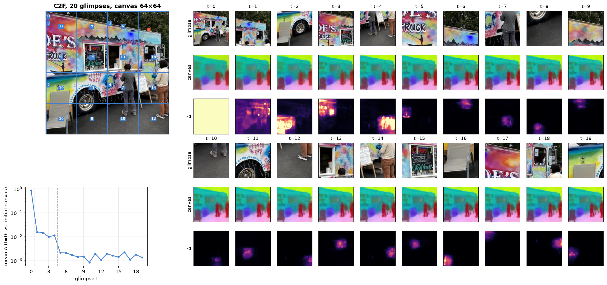

*C2F on one scene. Left: the viewpoints in visiting order. Right, for each glimpse: the glimpse, the canvas (PCA of
the layer-normalized patches, as in the paper's appendix G) and the canvas change since the previous step.*

### Reproduction

The rollout script gives the same mIoU after each of the 21 glimpses as the official CLI (RFS, 64×64 canvas). On the
64×64 canvas, it stays within 0.43 points of the paper's exported curves for all six policies. The largest gaps are
for the two seed-dependent policies, R-IID (0.43) and F2C (0.37). C2F, averaged over 5 seeds, is within 0.17 points
(0.19 on the 32×32 canvas).

The DINOv3 baselines with the released probes give 28.83 for ViT-B/16 at 128 px and 47.19 at 512 px. The paper
reports 28.8 and 47.2.

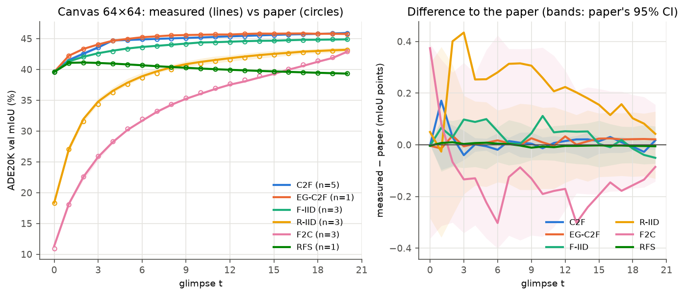

### Accuracy against compute

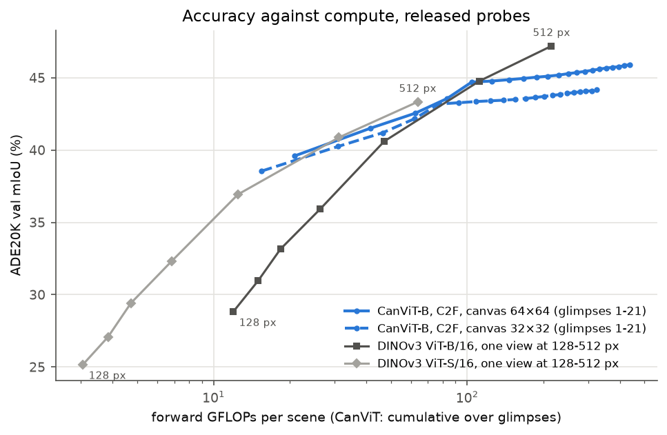

On 512 px scenes, C2F stays on the frontier of the two DINOv3 models up to about 100 GFLOPs:

- One glimpse (20.8 GFLOPs, 39.6%) beats DINOv3 ViT-B at 192 px (26.3 GFLOPs, 35.9%).
- Five glimpses (104 GFLOPs, 44.7%) match ViT-B at 384 px (112 GFLOPs, 44.8%).

Past that point, C2F flattens: 21 glimpses (438 GFLOPs) reach 45.9%, below DINOv3 ViT-B at 512 px (47.2%,
215 GFLOPs). A glimpse costs the same whatever the scene size, so the comparison that matters is on scenes larger
than 512 px. On Cityscapes at 1024 px, CanViT leads DINOv3 only on small budgets (about 200 GFLOPs); DINOv3 at
1024 px is 4.4 points ahead at its own cost (section [Cityscapes at 1024 px](#cityscapes-at-1024-px-past-the-pretraining-resolution)).

### Long rollouts: repetition, not length, degrades the canvas

Pretraining rollouts average four glimpses. The table follows four policies over 85 glimpses, on a 64×64 canvas:

| Policy (seeds) | t = 1 | t = 20 | t = 84 |
|---|---|---|---|
| RFS (deterministic) | 41.06 | 39.32 | 37.55 |
| C2F (2) | 41.22 | 45.91 | 43.65 |
| F-IID (2) | 41.56 | 45.02 | 44.95 |
| R-IID (2) | 27.46 | 43.35 | 45.20 |

- **Random viewpoints do not drift.** F-IID peaks at 45.19 at t = 40, and R-IID is still rising at t = 84.
- **Repeating the full view does.** RFS falls from 41.12 at t = 2 to 37.55. Meanwhile the raw canvas norm grows
  linearly, because Writes add unnormalized residuals.
- **C2F peaks at the end of level 2 (t = 20).** It then loses 2.3 points over level 3, whose tiles are upsampled 2×
  from the 512 px scene. The next section traces this loss to Writes that land outside the glimpse.

Three controls continue the same 21 C2F glimpses differently (seed 0). Change in mIoU from t = 20 to t = 84:

- level 3: −2.28;
- level-2 tiles again: −1.24;
- the full scene again: −5.77 (down to 40.17).

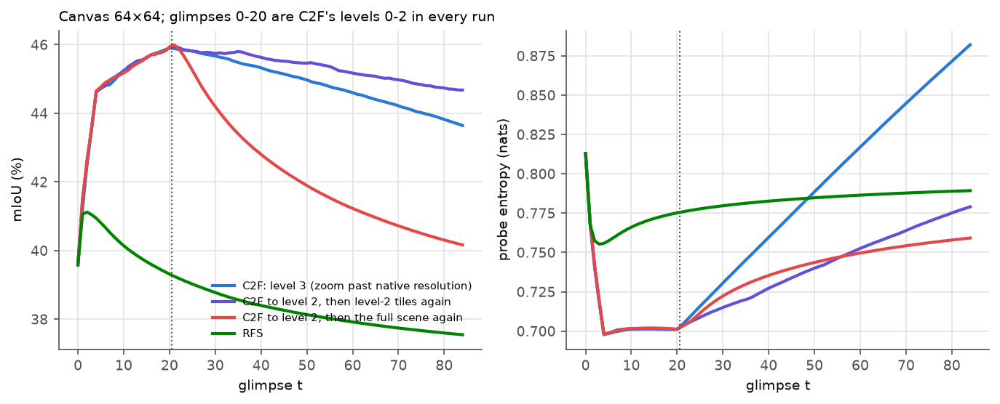

A probe-free metric orders the policies the same way. It is the paper's reconstruction metric (official CLI): how
well a 32×32 canvas predicts DINOv3's features of the scene, as a cosine similarity.

- RFS falls from 0.800 (t = 1) to 0.753.
- C2F falls from 0.837 (t = 20) to 0.803.
- F-IID and R-IID end near 0.82.

The canvas norm, the change per glimpse and the probe entropy for these rollouts are in
[`outputs/ade20k_long_rollouts.png`](outputs/ade20k_long_rollouts.png).

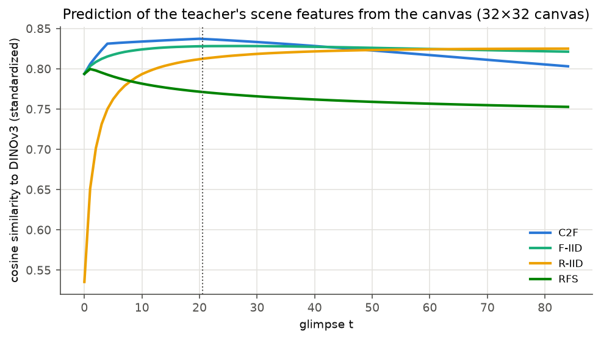

### Writes outside the glimpse cause C2F's level-3 drop

A Canvas Attention Write lets every canvas cell attend to the glimpse's tokens, so a glimpse also changes the cells
it did not see. [`scripts/write_leakage.py`](scripts/write_leakage.py) measures this along C2F on 256 ADE20K scenes
(64×64 canvas). Mean norm of the summed Write residual in a cell outside the crop, relative to a cell inside:

| C2F level (tiles) | 1 (4) | 2 (16) | 3 (64) |
|---|---|---|---|
| outside / inside | 0.28 | 0.18 | 0.16 |

The leak is strongest next to the crop. At level 3, it is 0.61 within half a tile width of the crop and 0.12 beyond
four tile widths.

Over level 3, a cell receives the leaked residuals of the 63 glimpses of other tiles:

- They mostly point the same way: their sum is 8.3 times the residual from the cell's own glimpse.
- That sum is mostly one vector added to every cell: its mean over the canvas carries 88% of its energy.

Dropping the Write residuals outside the crop removes this. It is a forward hook with no retraining, and the canvas
registers keep their residuals. Applied from glimpse 21 on, it turns the level-3 drop into a gain (C2F, seed 0):

| Writes | t = 1 | t = 20 | t = 84 |
|---|---|---|---|
| released | 41.10 | 45.93 | 43.65 |
| kept in the crop from level 3 (t ≥ 21) | 41.10 | 45.93 | 46.40 |
| kept in the crop from level 2 (t ≥ 5) | 41.10 | 45.94 | 46.18 |
| kept in the crop from glimpse 1 | 40.56 | 45.47 | 45.63 |

- With seed 1, the first two rows end at 43.64 and 46.31 at t = 84.
- Level-3 tiles hold no new pixels on 512 px scenes. With local Writes, level 3 still adds 0.47 points.
- Over level 3, the mean canvas patch norm doubles with released Writes (27.5k to 58.2k). With local Writes, it grows
  by 12% (to 30.7k).
- On the 32×32 canvas of pretraining, C2F ends at 41.05 at t = 84 with released Writes. Local Writes end at 44.48
  from level 3 and at 43.81 from glimpse 1.
- **The paper's reconstruction metric agrees, without any probe.** It measures how well the 32×32 canvas predicts
  DINOv3's features of the scene (cosine similarity). For C2F with released Writes, it falls from 0.837 at t = 20
  to 0.803 at t = 84. With Writes kept in the crop from level 3, it keeps rising, to 0.839 at t = 84. Kept in the
  crop from level 2, they give the best t = 20 (0.839 against 0.837) and end at 0.837. From glimpse 1, they give
  0.835 at t = 20 and 0.831 at t = 84.
- The drop is not a bfloat16 artifact. On the first 500 images, C2F ends at 40.48 at t = 84 both in float32 and under
  the official bfloat16 autocast. In float32, local Writes from level 3 raise it to 42.86.
- From glimpse 1, local Writes cost 0.4 points at t = 20 (−0.46, −0.48 and −0.34 for seeds 0-2), from the first
  level-1 glimpse on. From level 2, they cost nothing up to t = 20. On ADE20K, the writes outside the crop help only
  during level 1, whose glimpses each cover a quarter of the scene.
- RFS, and the full scene repeated after C2F, are unchanged: their glimpse covers the whole canvas. Their decline
  does not come from writes outside the crop.

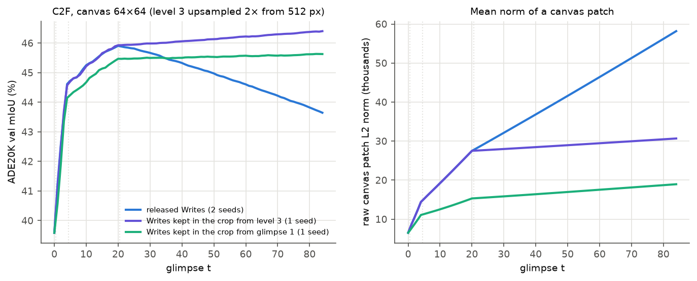

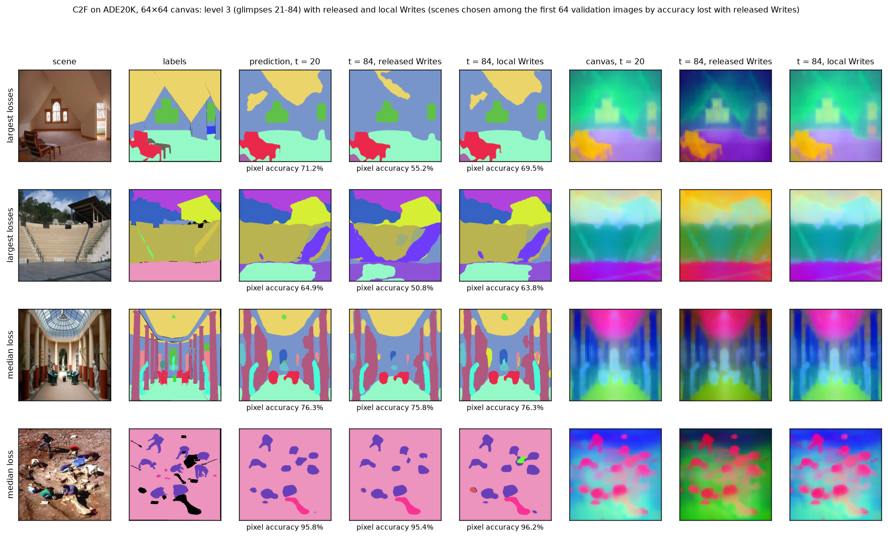

*Four ADE20K scenes, chosen among the first 64 validation images by the pixel accuracy they lose over level 3 with
released Writes: the two largest losses (16.0 and 14.1 points) and two at the median loss (0.4 points). With released
Writes, level 3 changes the colors of the whole canvas (one PCA basis per scene): it is the vector that the leak adds
to every cell. With local Writes, the canvas at t = 84 stays close to the one at t = 20. Made by
[`scripts/level3_canvas.py`](scripts/level3_canvas.py).*

**Writes also kept near the crop.** The leak is strongest within half a crop width of the crop. Keeping the Write
residuals there as well, and dropping them only farther away (C2F, seed 0):

| Writes | t = 1 | t = 20 | t = 84 |
|---|---|---|---|
| released | 41.10 | 45.93 | 43.65 |
| kept in the crop, from glimpse 1 | 40.56 | 45.47 | 45.63 |
| kept within half a crop width of the crop, from glimpse 1 | 41.02 | 45.98 | 45.95 |
| kept in the crop, from level 3 | 41.10 | 45.93 | 46.40 |
| kept within half a crop width of the crop, from level 3 | 41.10 | 45.93 | 46.33 |

- The harm comes from the leak far from the glimpse: from level 3, the margin costs 0.07 points at t = 84.
- From glimpse 1, the margin removes the cost of local Writes during level 1. Its mean over t = 1-20 is 44.86,
  against 44.89 with released Writes and 44.41 without the margin. It still gains 2.3 points by t = 84, and needs no
  threshold on the glimpse scale.

**Other policies.** Writes kept in the crop from glimpse 1 (seed 0), change against released Writes:

| Policy | t = 1 | t = 20 | t = 84 |
|---|---|---|---|
| R-IID | −3.66 | −1.81 | −0.16 |
| F2C (21 glimpses, finest tiles first) | −4.97 | +1.72 | |
| F-IID | −0.82 | +0.12 | +0.91 |

- With local Writes, a cell that no glimpse has covered receives nothing. That costs most when the first glimpses
  are small (R-IID, F2C).
- F2C ends with the full scene and reaches 44.56 at t = 20 (released: 42.84).
- EG-C2F loses 0.45 points on average over t = 1-20. Over 85 glimpses with released Writes, EG-C2F drops like C2F:
  45.75 at t = 20, 43.53 at t = 84. With Writes kept in the crop from level 2, it ends at 46.24 (next table).

**Local Writes for small glimpses only.** Glimpses of scale ≤ 1/4 keep their Writes in the crop, and larger ones
write everywhere; for C2F, this is local Writes from level 2. On the three C2F tile orders, F-IID and R-IID, the
rule costs at most 0.06 points on average over t = 1-20 and gains by t = 84:

| Policy (seed 0) | mean over t = 1-20, released / rule | t = 84, released / rule |
|---|---|---|
| C2F | 44.89 / 44.83 | 43.65 / 46.18 |
| EG-C2F | 45.21 / 45.20 | 43.53 / 46.24 |
| C2F, highest canvas contrast first (no probe) | 45.20 / 45.15 | 43.59 / 46.23 |
| F-IID | 44.11 / 44.15 | 44.88 / 45.38 |
| R-IID | 39.60 / 39.59 | 45.19 / 45.50 |

F2C, whose first 16 glimpses are small, still loses early with it (30.90 against 34.58 over t = 1-20). It ends
higher, though: 45.38 at t = 20, against 42.84. On the reconstruction metric, F-IID with the rule ends at 0.828 at
t = 84, against 0.821 with released Writes.

**Writes also kept in the cells that no glimpse has covered yet** (local Writes from glimpse 1, seed 0) recover the
first glimpses, but not the rest:

| Policy | t = 1, released / local / local + unseen | mean over t = 1-20, released / local / local + unseen |
|---|---|---|
| R-IID | 27.40 / 23.74 / 27.21 | 39.60 / 36.28 / 39.04 |
| F2C | 18.05 / 13.08 / 17.78 | 34.58 / 30.57 / 32.76 |

The leak does more than fill the cells no glimpse has seen: it also helps the cells already seen. F2C, whose first
16 glimpses tile level 2, scores 35.53 at t = 15 this way, below both released Writes (39.23) and local Writes
(39.48). R-IID ends at 45.51 at t = 84, as with the rule for small glimpses (45.50), which keeps the first 20
glimpses intact.

**The leak goes through an attention sink.** A Write's keys and values are all the glimpse's tokens. They include 7
prefix tokens (VPE, recurrent CLS, 5 backbone registers) that SR-RoPE leaves unrotated, so every canvas cell sees
them the same way, wherever it is. Attention of the canvas cells, mean over the three Writes (256 scenes):

| C2F level | 1 | 2 | 3 |
|---|---|---|---|
| on the prefix, cells inside the crop | 0.31 | 0.34 | 0.46 |
| on the prefix, cells outside the crop | 0.86 | 0.91 | 0.95 |
| on backbone register 3, cells outside the crop | 0.55 | 0.82 | 0.93 |

- Cells far from the glimpse attend almost only to register 3, which acts as an attention sink. Its value is not
  zero, so each glimpse adds it to every cell it does not see.
- Over level 3, the leak's part from the prefix sums to a vector that is 97% the same in every cell. Its part from
  the patch tokens is 63% common.
- The model pretrained on 1024 px scenes leaks as much, on the same 256 scenes: 0.28, 0.18 and 0.18 outside the crop
  relative to inside, for levels 1-3. Its outside cells also attend to backbone register 3 (0.92 at level 3). Its
  smaller level-3 drop on Cityscapes does not come from a smaller leak.

Removing only part of the leak is worse than keeping all of it (C2F, seed 0):

| Writes outside the crop | t = 1 | t = 20 | t = 84 |
|---|---|---|---|
| released (both parts) | 41.10 | 45.93 | 43.65 |
| dropped, from glimpse 1 | 40.56 | 45.47 | 45.63 |
| only the part from the prefix, from glimpse 1 | 40.77 | 42.97 | 19.62 |
| only the part from the patch tokens, from glimpse 1 | 40.73 | 44.25 | 39.83 |
| only their mean removed, from glimpse 1 | 40.98 | 42.18 | 34.69 |
| only their mean removed, from level 3 | 41.10 | 45.93 | 44.19 |

With the mean removed from level 3 on, the mIoU first peaks at 46.22 (t = 29).

Removing register 3's part from every Write, in every cell, needs no viewpoint, but it does not help either:
44.39 at t = 20 and 43.17 at t = 84 (from glimpse 1). The canvas norm then grows even more: 64.0k at t = 84, against
58.2k with the released Writes. The sink shows where the outside cells' attention goes, but its value alone is not
the cause.

### Most of C2F's gain does not need new pixels

This test removes the detail finer than 128 px from the scenes (antialiased downsampling, then bilinear upsampling),
so no later glimpse holds information the first one lacks. Gain of C2F from t = 0 to t = 20 (seed 0):

| Scene | Gain (points) |
|---|---|
| original 512 px | +6.35 |
| detail of 256 px | +5.58 |
| detail of 128 px | +4.12 |

Without any new detail, C2F keeps two thirds of its gain.

A 128×128 canvas read by the 64×64 probe adds 0.2 points at t = 20 (46.15 vs 45.94), for twice the FLOPs per
glimpse.

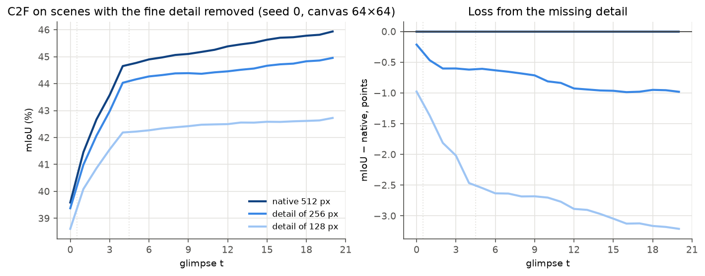

### Tile order within C2F's levels

Mean mIoU over glimpses 1-20:

| Order of the tiles in each level | 64×64 | 32×32 |
|---|---|---|
| lowest probe entropy first (EG-C2F reversed) | 44.50 | 43.00 |
| random, the paper's C2F (5 seeds, ± sd) | 44.92 ± 0.08 | 43.33 ± 0.04 |
| highest canvas contrast first (no probe) | 45.20 | 43.54 |
| highest probe entropy first, the paper's EG-C2F | 45.21 | 43.66 |
| most wrongly labeled pixels first (oracle: reads the labels) | 45.34 | 43.79 |

**Canvas contrast** needs no task head. A canvas cell's score is the mean cosine dissimilarity of its
layer-normalized patch to its four neighbours, and a tile's score is the mean over its cells.

- It matches EG-C2F on the 64×64 canvas and comes 0.12 points below it on the 32×32 canvas.
- The oracle bounds what any order gains over random at about 0.4-0.5 points.

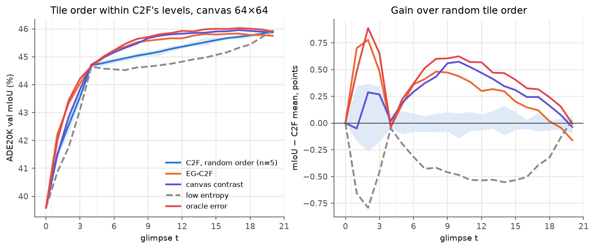

### Training-free changes that did not help

- **Anti-aliased glimpse extraction** (the crop at its native resolution, then an antialiased resize) lowers mIoU:
  - −0.48 at t = 0 on the 64×64 canvas;
  - −0.17 for C2F and −0.46 for RFS at t = 20.

  The model was pretrained on aliased bilinear glimpses. See
  [`outputs/ade20k_antialiasing.png`](outputs/ade20k_antialiasing.png).
- **Halving every Write residual after the first glimpse** slows RFS's decline (+0.30 at t = 84), but costs C2F up
  to 0.89 points (−0.50 at t = 20).
- **Glimpses of 256 px** (16×16 patches, 79 GFLOPs per glimpse instead of 21), on the first 500 images:
  - the full view gains 1.1 points at t = 0 (38.47 vs 37.37);
  - C2F ends lower at t = 20 (40.79 vs 42.02).

  DINOv3 gains 11.8 points from 128 to 256 px. CanViT, pretrained on 128 px glimpses only, does not.
- **Damping Writes where the canvas was already seen at a finer scale.** Inside the glimpse, Writes are multiplied by
  min(1, finest scale seen / glimpse scale)^k.
  - It is an exact no-op for C2F.
  - It hurts F2C at t = 20: −0.94, −1.69 and −2.62 for k = 0.5, 1 and 2 (seed 0).
  - It halves the loss from repeating the full scene after C2F (43.10 vs 40.17 at t = 84), which again points at
    repetition rather than coarseness.

### Cityscapes at 1024 px: past the pretraining resolution

Each Cityscapes validation image (1024×2048) is split into two 1024 px scenes, for 1,000 scenes. mIoU is over the 19
classes, at 1024 px. No Cityscapes probe is released, so [`scripts/cityscapes.py`](scripts/cityscapes.py) trains a
linear probe on the frozen 64×64 canvas, as the paper does for ADE20K:

- 512 px training scenes, 10 R-IID glimpses each, 8,000 steps;
- step selected on the validation split, with F-IID glimpses.

C2F to level 3 takes 85 glimpses. A level-3 tile spans 128 px of the 1024 px scene, so a glimpse can show it at full
resolution. Pretraining used 512 px scenes, where glimpses this small are always upsampled 2×.

| Writes | t = 20 | t = 84, level 3 upsampled from 512 px | t = 84, level 3 from 1024 px |
|---|---|---|---|
| released | 61.80 | 58.91 | 59.20 |
| kept in the crop from level 3 | 61.80 | 63.17 | 63.57 |
| kept in the crop from level 2 | 63.04 | | 64.70 |
| kept in the crop from glimpse 1 | 63.26 | 64.08 | 64.49 |

Levels 0-2 come from the 512 px scene, and t = 0 gives 49.51. Over three C2F seeds (mean ± sd), released Writes give
61.71 ± 0.11 at t = 20 and 59.13 ± 0.09 at t = 84. Writes kept in the crop from level 2 give 63.04 ± 0.02 and
64.65 ± 0.06.

- **Real detail adds little.** Over level 3, glimpses from the 1024 px scene beat upsampled ones by 0.29 to 0.41
  points at t = 84.
- **Keeping the Writes in the crop adds 4.4 points** at t = 84 (59.20 to 63.57).
- **Reading levels 0-2 from the 1024 px scene as well** changes the mIoU by at most 0.24 points.
- **Small classes suffer most from writes outside the crop.** With released Writes, from t = 20 to t = 84:
  - truck −9.6, traffic sign −9.3, pole −7.5, rider −7.2;
  - road +0.1, car +0.2.

  With Writes kept in the crop from level 3, every class gains, small ones most: traffic sign +4.7, traffic light
  +4.2.
- **Unlike on ADE20K, local Writes from glimpse 1 help before level 3:** +1.46 points at t = 20. Of that gain, 1.24
  points remain when Writes are kept in the crop from level 2 only. Keeping them in the crop from level 2 gives the
  best t = 84 (64.70).
- **A 128×128 canvas** (8 px cells at 1024 px), read by the 64×64 probe, with Writes kept in the crop from level 2,
  reaches 65.06 at t = 84 (+0.36), for twice the FLOPs per glimpse (42.3 GFLOPs).
- **Subtracting only the mean of the residuals outside the crop** (from glimpse 1, level 3 from the 1024 px scene)
  fails here too: 59.50 at t = 20, 52.48 at t = 84.
- **EG-C2F:**
  - With released Writes, it gains 0.86 points in its first 10 level-3 glimpses (62.70 at t = 30), then loses them.
  - With Writes kept in the crop from glimpse 1, it reaches 64.40 at t = 36. C2F needs 84 glimpses for the same
    level (64.49).

**A CanViT-B pretrained on 1024 px scenes.** The Hub also holds
`canvitb16-add-vpe-pretrain-g128px-s1024px-sa1b-dv3b16-experimental`, pretrained on 1024 px SA-1B scenes. It is in
an older checkpoint format, which [`scripts/convert_legacy_checkpoint.py`](scripts/convert_legacy_checkpoint.py)
converts. Its probe is trained the same way, on 1024 px scenes. Levels 0-2 come from the 512 px scene and level 3
from the 1024 px scene, as above:

| Writes | t = 0 | t = 20 | t = 84 |
|---|---|---|---|
| released | 51.57 | 64.96 | 63.65 |
| kept in the crop from level 3 | 51.57 | 64.96 | 66.49 |
| kept in the crop from glimpse 1 | 51.57 | 65.88 | 66.63 |

- Its level-3 drop is half the flagship's (−1.31 points). Local Writes turn it into a gain of 1.53 points.
- **Real detail still adds little.** At t = 84:
  - level-3 tiles upsampled from the 512 px scene give 63.37 (−0.28);
  - every glimpse from the 1024 px scene, its pretraining scene size, gives 63.89 (+0.24).
- **EG-C2F with released Writes** peaks at 66.02 (t = 30), then falls to 64.25.
- **With every glimpse from the 1024 px scene and Writes kept in the crop from level 2**, C2F reaches 67.16 at
  t = 84 and EG-C2F 67.57 (t = 77). After 8 glimpses (167 GFLOPs), EG-C2F already scores 64.10.
- The two models' probes are trained on different scene sizes (1024 and 512 px). The 3.16 points between them at
  t = 20 therefore mix model and probe; a flagship probe trained on 1024 px scenes is queued.

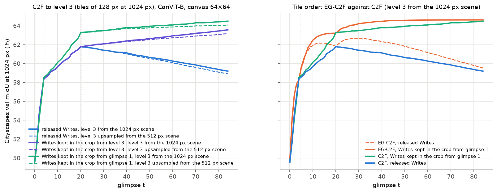

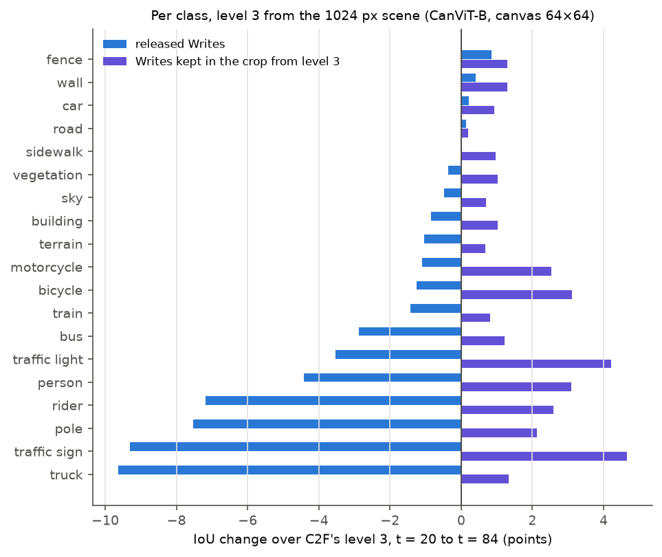

**Against DINOv3.** DINOv3 ViT-B/16 sees the scene once, resized to its input size, with a probe trained the same
way at that size. It scores 63.78 at 512 px (215 GFLOPs) and 71.99 at 1024 px (1,322 GFLOPs). CanViT is ahead only
on small budgets:

| Model | GFLOPs | mIoU |
|---|---|---|
| DINOv3 ViT-B/16, 512 px | 215 | 63.78 |
| CanViT-B pretrained on 1024 px, EG-C2F, Writes kept in the crop from level 2, 10 glimpses | 208 | 64.79 |
| DINOv3 ViT-B/16, 1024 px | 1,322 | 71.99 |
| same CanViT, 64 glimpses | 1,334 | 67.56 |

The flagship CanViT stays below DINOv3 at 512 px for the same cost (61.83 after 10 glimpses of EG-C2F). DINOv3 at
768 px is queued.

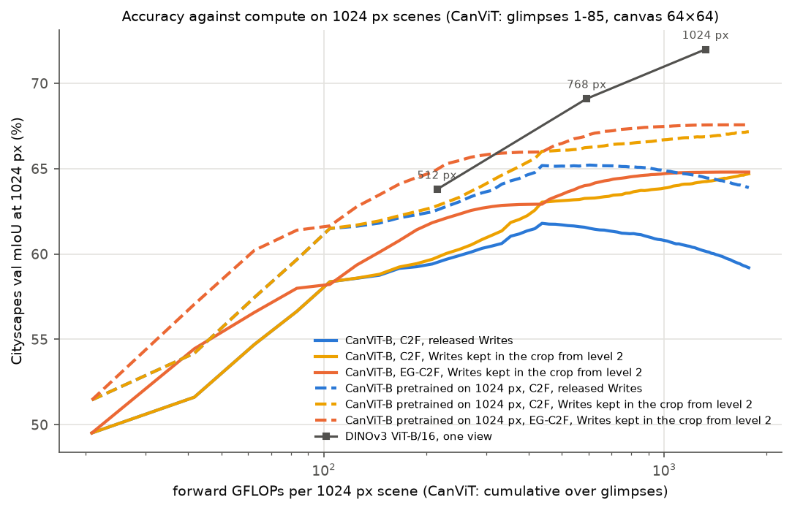

### Depth on NYU Depth v2: later glimpses add little

The paper does not test depth. [`scripts/nyu_depth.py`](scripts/nyu_depth.py) trains linear depth probes on frozen
features, on the labeled NYU Depth v2 set:

- 700 training images and 654 test images (the official split; the last 95 of its 795 training images select the
  probe's step);
- a scene is the central 480×480 square of an image, resized to 512 px. Errors are computed at 480 px, inside the
  crop of Eigen et al.;
- the probe is the paper's segmentation head over 256 depth bins (0-10 m), trained with the scale-invariant log
  loss. The canvas probe is trained on 10 R-IID glimpses per scene, as for Cityscapes.

| Features | GFLOPs | RMSE (m) | AbsRel | δ < 1.25 (%) |
|---|---|---|---|---|
| DINOv3 ViT-B/16, 128 px | 12 | 0.550 | 0.152 | 77.9 |
| CanViT-B, one glimpse (the full scene) | 21 | 0.554 | 0.155 | 77.9 |
| DINOv3 ViT-B/16, 256 px | 47 | 0.475 | 0.130 | 84.0 |
| CanViT-B, C2F, 10 glimpses | 208 | 0.525 | 0.146 | 80.0 |
| DINOv3 ViT-B/16, 512 px | 215 | 0.445 | 0.122 | 86.2 |
| CanViT-B, C2F, 21 glimpses | 438 | 0.524 | 0.149 | 79.9 |

- One glimpse matches DINOv3 at 128 px, but later glimpses add little. Over 20 more glimpses, C2F lowers the RMSE by
  0.030 m and F-IID by 0.027 m. On ADE20K, the same C2F glimpses add 6.35 points of mIoU.
- DINOv3 at 256 px (47 GFLOPs) beats CanViT at every budget.
- The canvas is trained to predict DINOv3's features of the 512 px scene. For segmentation, its probe comes close to
  DINOv3's at 512 px (45.9 against 47.2 mIoU); for depth, it does not (0.524 against 0.445 m).
- RFS degrades depth as it degrades segmentation: from 0.554 m at t = 0 to 0.586 m at t = 20.
- Over 21 glimpses, Writes kept in the crop from level 2 change nothing (0.527 m at t = 20).

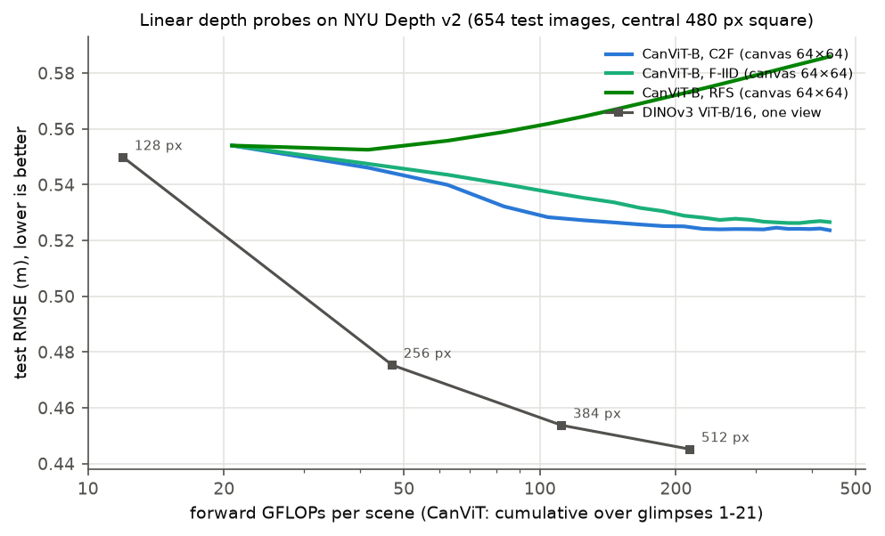

### Cost of the asymmetric Canvas Attention

The released model has no learned projections on the canvas side; the QKVO ablation has projections on both sides.

| Canvas | GFLOPs per glimpse, asymmetric / QKVO | Latency at batch size 32, asymmetric / QKVO |
|---|---|---|
| 64×64 | 20.8 / 124.3 | 103 / 158 ms |
| 128×128 | 42.3 / 455.0 | 361 / 580 ms |

FLOPs are analytic (`canvit_pytorch.flops`). Latency is measured on an RTX 3090 with bfloat16 autocast. At batch
size 1, both variants take 15-23 ms, a time bounded by kernel launches.

### Limits

- Three datasets. On Cityscapes and NYU Depth v2, the probes are trained here. Every Cityscapes run uses one seed,
  except the comparison of released Writes with Writes kept in the crop from level 2 (three seeds). Each depth
  probe is trained once.
- Deterministic policies (RFS, EG-C2F and the scored tile orders) ran once; the others ran over the seeds shown.
  Variants of C2F use seed 0.
- Nothing in CanViT is retrained, so the conclusions hold for the released model. Local Writes are a change at
  inference only; a model pretrained with them may behave differently.

## Setup

```bash
python3.12 -m venv .venv
.venv/bin/pip install "canvit-pytorch[demo,evaluate]==0.3.0"
git clone https://github.com/m2b3/CanViT external/CanViT   # the paper's exported results, sample images
```

ADE20K (`ADEChallengeData2016`) goes wherever `ADE20K_ROOT` points, Cityscapes (`gtFine_trainvaltest.zip` and
`leftImg8bit_trainvaltest.zip`, unzipped) wherever `CITYSCAPES_ROOT` points, and NYU Depth v2
(`nyu_depth_v2_labeled.mat` and `splits.mat`) wherever `NYU_ROOT` points; the queue runners and scripts set the
defaults. The depth script also needs `h5py` and `scipy`. DINOv3 is gated on the Hugging Face Hub: request access, then `hf auth login`.

## Contents

| Path | What it does |
| --- | --- |
| `scripts/c2f_rollout.py` | One scene under C2F: numbered viewpoints, the canvas after each glimpse (the paper's PCA protocol) and the per-glimpse canvas change. |
| `scripts/ade20k_rollouts.py` | ADE20K validation mIoU after every glimpse, with canvas statistics, for the paper's policies and for variants: other tile orders within C2F's levels, C2F continued past level 2 by revisits, anti-aliased glimpses, scenes without fine detail, a probe read on a larger canvas, scaled Write residuals, Writes damped where the canvas was already seen at a finer scale, Writes kept in the glimpse's crop. Uses the official model, probe, transform and metric. |
| `scripts/level3_canvas.py` | The canvas and the probe's prediction after level 3 of C2F with released and local Writes, on a few ADE20K scenes. |
| `scripts/write_leakage.py` | How much of each Write lands outside the glimpse's crop, per C2F level, and how much of it comes from the glimpse's prefix tokens. |
| `scripts/local_writes.py` | The training-free restrictions of the Writes to the glimpse's crop that the rollout scripts share. |
| `scripts/reconstruction_rollouts.py` | The paper's reconstruction metric (no task probe) after every glimpse, with released or local Writes. |
| `scripts/nyu_depth.py` | NYU Depth v2: linear depth probes on frozen features (CanViT's canvas, DINOv3's patch features), then test depth errors after every glimpse of CanViT and for DINOv3 at several input sizes. |
| `scripts/cityscapes.py` | Cityscapes at its native 1024 px: linear probes trained on frozen features (CanViT's canvas, DINOv3's patch features), then validation mIoU of C2F rollouts down to glimpses finer than the 512 px scenes of pretraining (with released or local Writes), and of DINOv3 at several input sizes. |
| `scripts/convert_legacy_checkpoint.py` | Converts a checkpoint in the canvit-pytorch 0.1 format (the Hub's experimental 1024 px CanViT-B) to the current format. |
| `scripts/run_queue.sh`, `scripts/run_official_queue.sh`, `scripts/run_commands.sh`, `queues/` | Run a list of experiments one after another, skipping finished ones: `ade20k_rollouts.py` runs, official `canvit_pytorch.evaluate` runs, and any Python command. |
| `scripts/plot_results.py` | Figures in `outputs/` and the table `results/summary.md` from the saved results. |
| `scripts/canvas_attention_cost.py` | FLOPs and GPU latency of a glimpse with asymmetric and QKVO Canvas Attention. |
| `scripts/export_official.py` | Collects the official CLI's runs (DINOv3 baselines, reconstruction) into `results/official.json`, with the FLOPs of each model. |
| `exercises/` | Canvas Attention and SR-RoPE to write from the paper, with a checker against the released model. |

## Checks

- On RFS with a 64×64 canvas, `scripts/ade20k_rollouts.py` gives the same mIoU after each of the 21 glimpses as
  `python -m canvit_pytorch.evaluate ade20k-segmentation-canvit`.
- Its tile-ordered C2F with the probe's entropy as score chooses the same viewpoints as the official EG-C2F.
- On RFS (21 glimpses), `scripts/reconstruction_rollouts.py` gives the same four reconstruction metrics after each
  glimpse as `python -m canvit_pytorch.evaluate reconstruction` (difference 0).

Results are in `results/` (one JSON file per run, with its configuration) and summarized in `results/summary.md`.
