# Experiments with CanViT

Experiments with the released [CanViT](https://github.com/m2b3/CanViT) (Canvas Vision Transformer,
arXiv:2603.22570) active-vision model: reproducing its ADE20K results and testing it in settings the paper does not
cover. Everything here uses the published `canvit-pytorch` package and the released checkpoints from the Hugging
Face Hub. CanViT stays frozen, and only linear probes are trained where none is released (Cityscapes), except in the
sections [Learned Writes](#learned-writes) and
[Primate vision](#primate-vision-eye-movements-retinas-and-a-canvas-that-learns-its-shape), which fine-tune parts of
it.

## Results

Unless a section says otherwise: ADE20K validation (2,000 images, 512 px scenes), with the released CanViT-B
(`canvitb16-add-vpe-pretrain-g128px-s512px-in21k-dv3b16-2026-02-02`) and its released linear probes, all frozen.
mIoU is in %, and glimpses are counted from t = 0. Runs use bfloat16 autocast on one RTX 3090. Every condition is in
[`results/summary.md`](results/summary.md).

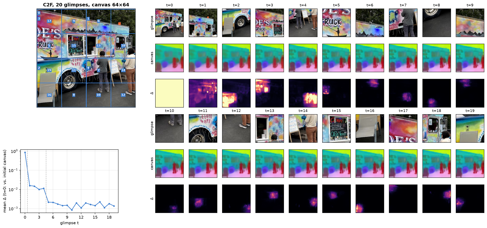

*C2F on one scene. Left: the viewpoints in visiting order. Right, for each glimpse: the glimpse, the canvas (PCA of
the layer-normalized patches, as in the paper's appendix G) and the canvas change since the previous step.*

### Reproduction

The rollout script gives the same mIoU after each of the 21 glimpses as the official CLI (RFS, 64×64 canvas). On the
64×64 canvas, it stays within 0.43 points of the paper's exported curves for all six policies. The largest gaps are
for the two seed-dependent policies, R-IID (0.43) and F2C (0.37). C2F, averaged over 5 seeds, is within 0.17 points
(0.19 on the 32×32 canvas).

The DINOv3 baselines with the released probes give 28.83 for ViT-B/16 at 128 px and 47.19 at 512 px. The paper
reports 28.8 and 47.2.

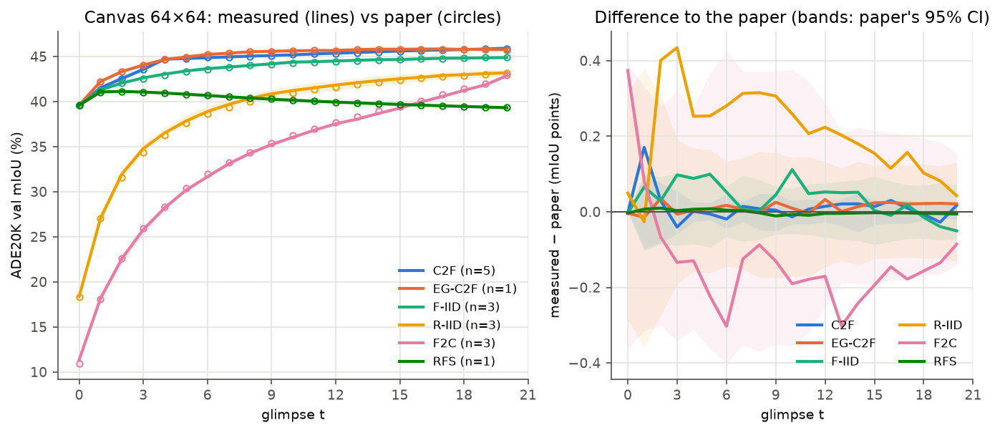

### Accuracy against compute

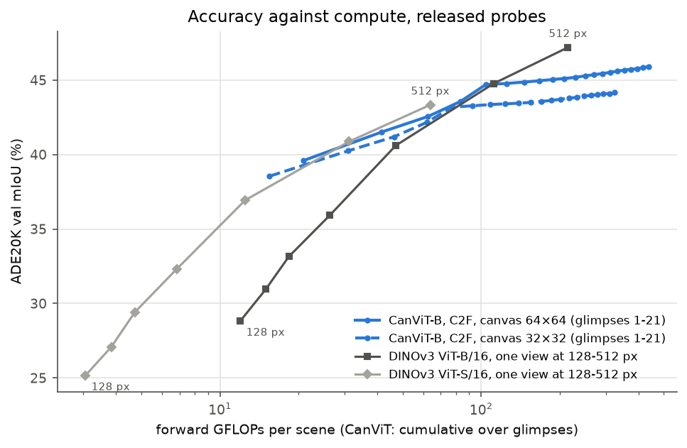

On 512 px scenes, C2F stays on the frontier of the two DINOv3 models up to about 100 GFLOPs:

- One glimpse (20.8 GFLOPs, 39.6%) beats DINOv3 ViT-B at 192 px (26.3 GFLOPs, 35.9%).
- Five glimpses (104 GFLOPs, 44.7%) match ViT-B at 384 px (112 GFLOPs, 44.8%).

Past that point, C2F flattens: 21 glimpses (438 GFLOPs) reach 45.9%, below DINOv3 ViT-B at 512 px (47.2%,
215 GFLOPs). A glimpse costs the same whatever the scene size, so the comparison that matters is on scenes larger
than 512 px. On Cityscapes at 1024 px, CanViT leads DINOv3 only on small budgets (about 200 GFLOPs); DINOv3 at
1024 px is 4.4 points ahead at its own cost (section [Cityscapes at 1024 px](#cityscapes-at-1024-px-past-the-pretraining-resolution)).

### Long rollouts: repetition, not length, degrades the canvas

Pretraining rollouts average four glimpses. The table follows four policies over 85 glimpses, on a 64×64 canvas:

| Policy (seeds) | t = 1 | t = 20 | t = 84 |
|---|---|---|---|
| RFS (deterministic) | 41.06 | 39.32 | 37.55 |
| C2F (2) | 41.22 | 45.91 | 43.65 |
| F-IID (2) | 41.56 | 45.02 | 44.95 |
| R-IID (2) | 27.46 | 43.35 | 45.20 |

- **Random viewpoints do not drift.** F-IID peaks at 45.19 at t = 40, and R-IID is still rising at t = 84.
- **Repeating the full view does.** RFS falls from 41.12 at t = 2 to 37.55. Meanwhile the raw canvas norm grows
  linearly, because Writes add unnormalized residuals.
- **C2F peaks at the end of level 2 (t = 20).** It then loses 2.3 points over level 3, whose tiles are upsampled 2×
  from the 512 px scene. The next section traces this loss to Writes that land outside the glimpse.

**Averaging a cell's Writes over its views stops RFS's decline.** Each repeated full view adds nearly the same
residual: the canvas norm grows by about 4.5k per glimpse, from 6.5k at t = 0 to 382k at t = 84. With the Write
residual into a cell multiplied by 1 / (1 + n), where n counts the earlier glimpses whose crop covered the cell, RFS
ends at 40.42 at t = 84 instead of 37.55, with a canvas norm of 24.7k. It peaks at 40.99 at t = 5 (released Writes:
41.12 at t = 2). The model never learned to stop writing what the canvas already holds. The averaging suits
repetition only: on C2F, it weakens the finer levels' Writes, and scores 44.37 at t = 20 (released: 45.93) and 40.48
at t = 84.

Three controls continue the same 21 C2F glimpses differently (seed 0). Change in mIoU from t = 20 to t = 84:

- level 3: −2.28;
- level-2 tiles again: −1.24, and −0.13 with Writes kept in the crop (next section);
- the full scene again: −5.77 (down to 40.17). Its glimpse covers the whole canvas, so this drop is repetition,
  not Writes outside the glimpse.

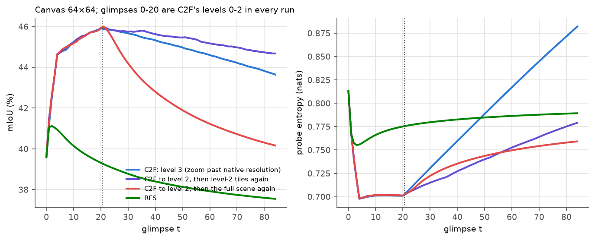

A probe-free metric orders the policies the same way. It is the paper's reconstruction metric (official CLI): how
well a 32×32 canvas predicts DINOv3's features of the scene, as a cosine similarity.

- RFS falls from 0.800 (t = 1) to 0.753.
- C2F falls from 0.837 (t = 20) to 0.803.
- F-IID and R-IID end near 0.82.

The canvas norm, the change per glimpse and the probe entropy for these rollouts are in
[`outputs/ade20k_long_rollouts.png`](outputs/ade20k_long_rollouts.png).

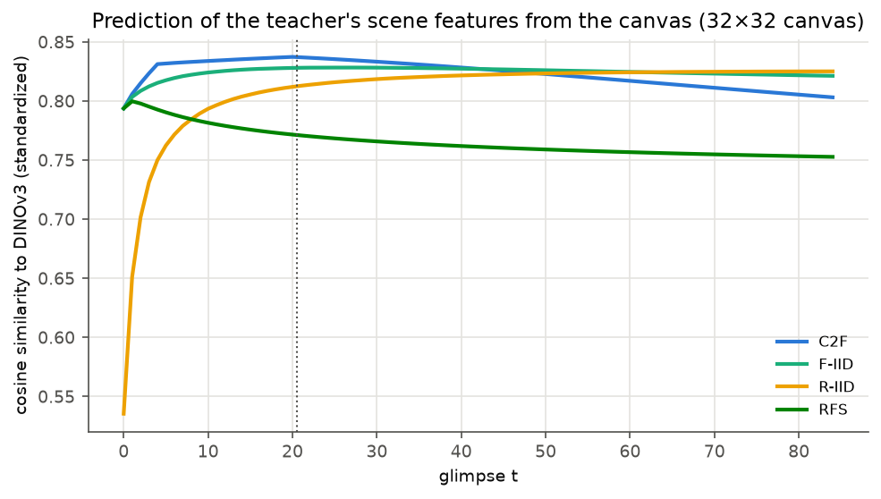

### Writes outside the glimpse cause C2F's level-3 drop

A Canvas Attention Write lets every canvas cell attend to the glimpse's tokens, so a glimpse also changes the cells
it did not see. [`scripts/write_leakage.py`](scripts/write_leakage.py) measures this along C2F on 256 ADE20K scenes
(64×64 canvas). Mean norm of the summed Write residual in a cell outside the crop, relative to a cell inside:

| C2F level (tiles) | 1 (4) | 2 (16) | 3 (64) |
|---|---|---|---|
| outside / inside | 0.28 | 0.18 | 0.16 |

The leak is strongest next to the crop. At level 3, it is 0.61 within half a tile width of the crop and 0.12 beyond
four tile widths.

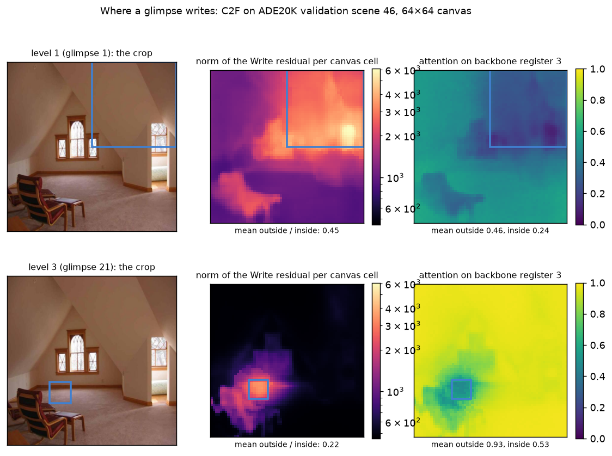

*One scene, two glimpses of C2F ([`scripts/write_leak_map.py`](scripts/write_leak_map.py)). Outside the crop, the
residual is not uniform: it follows the scene's layout. The level-3 tile, on the armchair, also writes into the rest
of the armchair. The cells it does not see put 0.93 of their attention on backbone register 3 (see below).*

Over level 3, a cell receives the leaked residuals of the 63 glimpses of other tiles:

- They mostly point the same way: their sum is 8.3 times the residual from the cell's own glimpse.
- That sum is mostly one vector added to every cell: its mean over the canvas carries 88% of its energy.

Dropping the Write residuals outside the crop removes this. It is a forward hook with no retraining, and the canvas
registers keep their residuals. Applied from glimpse 21 on, it turns the level-3 drop into a gain (C2F, seed 0):

| Writes | t = 1 | t = 20 | t = 84 |
|---|---|---|---|
| released | 41.10 | 45.93 | 43.65 |
| kept in the crop from level 3 (t ≥ 21) | 41.10 | 45.93 | 46.40 |
| kept in the crop from level 2 (t ≥ 5) | 41.10 | 45.94 | 46.18 |
| kept in the crop from glimpse 1 | 40.56 | 45.47 | 45.63 |

- With seed 1, the first three rows end at 43.64, 46.31 and 46.21 at t = 84.
- Level-3 tiles hold no new pixels on 512 px scenes. With local Writes, level 3 still adds 0.47 points.
- Over level 3, the mean canvas patch norm doubles with released Writes (27.5k to 58.2k). With local Writes, it grows
  by 12% (to 30.7k).
- On the 32×32 canvas of pretraining, C2F ends at 41.05 at t = 84 with released Writes. Local Writes end at 44.48
  from level 3 and at 43.81 from glimpse 1, and at 44.06 with a margin of one crop width (mean over t = 1-20: 43.46,
  against 43.39 released).
- **The paper's reconstruction metric agrees, without any probe.** It measures how well the 32×32 canvas predicts
  DINOv3's features of the scene (cosine similarity). For C2F with released Writes, it falls from 0.837 at t = 20
  to 0.803 at t = 84. With Writes kept in the crop from level 3, it keeps rising, to 0.839 at t = 84. Kept in the
  crop from level 2, they give the best t = 20 (0.839 against 0.837) and end at 0.837. From glimpse 1, they give
  0.835 at t = 20 and 0.831 at t = 84. Kept within half a crop width of the crop from glimpse 1, they give 0.839 and
  0.835; within one crop width, 0.840 (the best t = 20) and 0.836.
- The drop is not a bfloat16 artifact. On the first 500 images, C2F ends at 40.48 at t = 84 both in float32 and under
  the official bfloat16 autocast. In float32, local Writes from level 3 raise it to 42.86.
- From glimpse 1, local Writes cost 0.4 points at t = 20 (−0.46, −0.48 and −0.34 for seeds 0-2), from the first
  level-1 glimpse on. From level 2, they cost nothing up to t = 20. On ADE20K, the writes outside the crop help only
  during level 1, whose glimpses each cover a quarter of the scene.
- RFS, and the full scene repeated after C2F, are unchanged: their glimpse covers the whole canvas. Their decline
  does not come from writes outside the crop.

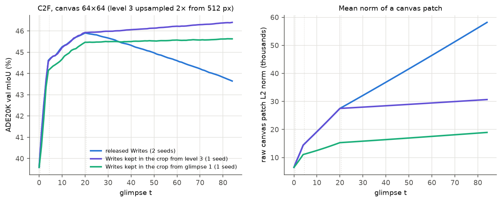

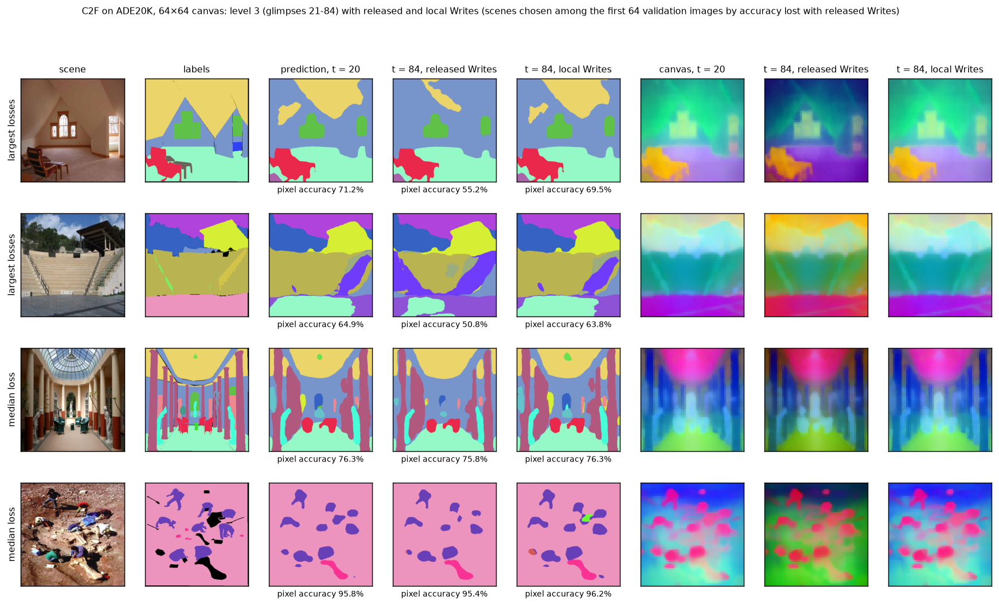

*Four ADE20K scenes, chosen among the first 64 validation images by the pixel accuracy they lose over level 3 with
released Writes: the two largest losses (16.0 and 14.1 points) and two at the median loss (0.4 points). With released
Writes, level 3 changes the colors of the whole canvas (one PCA basis per scene): it is the vector that the leak adds
to every cell. With local Writes, the canvas at t = 84 stays close to the one at t = 20. Made by
[`scripts/level3_canvas.py`](scripts/level3_canvas.py).*

**Writes also kept near the crop.** The leak is strongest within half a crop width of the crop. Keeping the Write
residuals there as well, and dropping them only farther away (C2F, seed 0):

| Writes | t = 1 | t = 20 | t = 84 |
|---|---|---|---|
| released | 41.10 | 45.93 | 43.65 |
| kept in the crop, from glimpse 1 | 40.56 | 45.47 | 45.63 |
| kept within half a crop width of the crop, from glimpse 1 | 41.02 | 45.98 | 45.95 |
| kept in the crop, from level 3 | 41.10 | 45.93 | 46.40 |
| kept within half a crop width of the crop, from level 3 | 41.10 | 45.93 | 46.33 |

- The harm comes from the leak far from the glimpse: from level 3, the margin costs 0.07 points at t = 84.
- From glimpse 1, the margin removes the cost of local Writes during level 1. Its mean over t = 1-20 is 44.86,
  against 44.89 with released Writes and 44.41 without the margin. It still gains 2.3 points by t = 84, and needs no
  threshold on the glimpse scale. Seed 1 gives the same: 45.96 at t = 20 and 45.89 at t = 84, against 45.89 and
  43.64 with released Writes.

**Width of the margin** (C2F, seed 0, Writes restricted from glimpse 1). On ADE20K, wider is better up to one crop
width, and a margin of two widths does slightly worse; on Cityscapes (1024 px, level 3 from the 1024 px scene),
narrower is better by t = 84:

| Margin (crop widths) | ADE20K, mean over t = 1-20 | ADE20K, t = 84 | Cityscapes, mean over t = 1-20 | Cityscapes, t = 84 |
|---|---|---|---|---|
| released Writes | 44.89 | 43.65 | 59.22 | 59.20 |
| 0 (crop only) | 44.41 | 45.63 | 59.71 | 64.49 |
| 0.25 | 44.70 | 45.77 | 59.90 | 64.20 |
| 0.5 | 44.86 | 45.95 | 59.83 | 63.83 |
| 1 | 44.98 | 46.14 | 59.56 | 63.15 |
| 2 | 44.94 | 45.99 | | |

With a margin of one crop width, a level-1 quadrant still writes everywhere, a level-2 tile into its 3×3 block of
tiles, and a level-3 tile into its 3×3 block.
With seed 1, a margin of one crop width gives the same: 45.01 over t = 1-20 and 46.10 at t = 84, against 44.91 and
43.64 with released Writes.

The margin also helps the policies that start with small glimpses, where the rule for small glimpses costs early.
Rules compared (seed 0): released Writes / the rule for small glimpses / a margin of half a crop width / a margin of
one crop width, both margins from glimpse 1:

| Policy | mean over t = 1-20 | last glimpse |
|---|---|---|
| C2F (t = 84) | 44.89 / 44.83 / 44.86 / 44.98 | 43.65 / 46.18 / 45.95 / 46.14 |
| EG-C2F (t = 84) | 45.21 / 45.20 / 45.25 / 45.33 | 43.53 / 46.24 / 45.99 / 46.10 |
| F-IID (t = 84) | 44.11 / 44.15 / 44.22 / 44.24 | 44.88 / 45.38 / 45.72 / 45.53 |
| R-IID (t = 84) | 39.60 / 39.59 / 39.79 / 39.86 | 45.19 / 45.50 / 45.65 / 45.60 |
| F2C (t = 20) | 34.58 / 30.90 / 35.19 / 36.04 | 42.84 / 45.38 / 44.95 / 44.74 |

- A margin of one crop width has the best mean over t = 1-20 for every policy, above released Writes.
- On F2C, the margins are the only change that does not lose early. After the 16 level-2 tiles (t = 15), a margin of
  half a crop width scores 42.42, against 39.23 with released Writes.
- By the last glimpse, the rule for small glimpses is ahead on C2F, EG-C2F and F2C, and the margins on F-IID and
  R-IID.
- The reconstruction metric agrees. With a margin of one crop width, C2F ends at 0.836 (released Writes: 0.803),
  F-IID at 0.830 (0.821) and R-IID at 0.829 (0.825). Their means over t = 1-20 stay within 0.002 of released Writes.

**A drift shared by every cell.** The share of the layer-normalized canvas common to all cells (the energy of their
mean) grows over level 3 from 0.787 to 0.830 with released Writes. With local Writes from level 3, it stays at
0.784. A readout-only test leaves the canvas unchanged and lets the probe read it with its mean over the cells held at
its value after t = 20 (C2F, seed 0):

| Writes, readout | t = 40 | t = 60 | t = 84 |
|---|---|---|---|
| released | 45.36 | 44.63 | 43.65 |
| released, mean held at t = 20 | 46.25 | 45.79 | 44.94 |
| kept in the crop from level 3 | 46.06 | 46.22 | 46.40 |
| kept in the crop from level 3, mean held at t = 20 | 46.19 | 46.43 | 46.69 |

- Early in level 3, the shared drift is the drop: with released Writes, the recentered readout peaks at 46.27
  (t = 36), above local Writes at that point.
- By t = 84, it recovers only 1.3 of the 2.3 points lost. The leak also damages what differs between cells.
- On local Writes, it adds 0.29 points at t = 84 (46.69, the best ADE20K score in this repository).
- On Writes kept within one crop width of the crop from glimpse 1, it lowers the mIoU instead: 45.42 at t = 84,
  against 46.14. The shared part of the canvas then barely grows (0.775 at t = 20, 0.782 at t = 84), and holding the
  mean removes useful changes.

**Other policies.** Writes kept in the crop from glimpse 1 (seed 0), change against released Writes:

| Policy | t = 1 | t = 20 | t = 84 |
|---|---|---|---|
| R-IID | −3.66 | −1.81 | −0.16 |
| F2C (21 glimpses, finest tiles first) | −4.97 | +1.72 | |
| F-IID | −0.82 | +0.12 | +0.91 |

- With local Writes, a cell that no glimpse has covered receives nothing. That costs most when the first glimpses
  are small (R-IID, F2C).
- F2C ends with the full scene and reaches 44.56 at t = 20 (released: 42.84).
- EG-C2F loses 0.45 points on average over t = 1-20. Over 85 glimpses with released Writes, EG-C2F drops like C2F:
  45.75 at t = 20, 43.53 at t = 84. With Writes kept in the crop from level 2, it ends at 46.24 (next table).

**Local Writes for small glimpses only.** Glimpses of scale ≤ 1/4 keep their Writes in the crop, and larger ones
write everywhere; for C2F, this is local Writes from level 2. On the three C2F tile orders, F-IID and R-IID, the
rule costs at most 0.06 points on average over t = 1-20 and gains by t = 84:

| Policy (seed 0) | mean over t = 1-20, released / rule | t = 84, released / rule |
|---|---|---|
| C2F | 44.89 / 44.83 | 43.65 / 46.18 |
| EG-C2F | 45.21 / 45.20 | 43.53 / 46.24 |
| C2F, highest canvas contrast first (no probe) | 45.20 / 45.15 | 43.59 / 46.23 |
| F-IID | 44.11 / 44.15 | 44.88 / 45.38 |
| R-IID | 39.60 / 39.59 | 45.19 / 45.50 |

F2C, whose first 16 glimpses are small, still loses early with it (30.90 against 34.58 over t = 1-20). It ends
higher, though: 45.38 at t = 20, against 42.84. On the reconstruction metric, F-IID with the rule ends at 0.828 at
t = 84, against 0.821 with released Writes.

**Writes also kept in the cells that no glimpse has covered yet** (local Writes from glimpse 1, seed 0) recover the
first glimpses, but not the rest:

| Policy | t = 1, released / local / local + unseen | mean over t = 1-20, released / local / local + unseen |
|---|---|---|
| R-IID | 27.40 / 23.74 / 27.21 | 39.60 / 36.28 / 39.04 |
| F2C | 18.05 / 13.08 / 17.78 | 34.58 / 30.57 / 32.76 |

The leak does more than fill the cells no glimpse has seen: it also helps the cells already seen. F2C, whose first
16 glimpses tile level 2, scores 35.53 at t = 15 this way, below both released Writes (39.23) and local Writes
(39.48). R-IID ends at 45.51 at t = 84, as with the rule for small glimpses (45.50), which keeps the first 20
glimpses intact.

**The leak goes through an attention sink.** A Write's keys and values are all the glimpse's tokens. They include 7
prefix tokens (VPE, recurrent CLS, 5 backbone registers) that SR-RoPE leaves unrotated, so every canvas cell sees
them the same way, wherever it is. Attention of the canvas cells, mean over the three Writes (256 scenes):

| C2F level | 1 | 2 | 3 |
|---|---|---|---|
| on the prefix, cells inside the crop | 0.31 | 0.34 | 0.46 |
| on the prefix, cells outside the crop | 0.86 | 0.91 | 0.95 |
| on backbone register 3, cells outside the crop | 0.55 | 0.82 | 0.93 |

- Cells far from the glimpse attend almost only to register 3, which acts as an attention sink. Its value is not
  zero, so each glimpse adds it to every cell it does not see.
- Over level 3, the leak's part from the prefix sums to a vector that is 97% the same in every cell. Its part from
  the patch tokens is 63% common.
- The model pretrained on 1024 px scenes leaks as much, on the same 256 scenes: 0.28, 0.18 and 0.18 outside the crop
  relative to inside, for levels 1-3. Its outside cells also attend to backbone register 3 (0.92 at level 3). Its
  smaller level-3 drop on Cityscapes does not come from a smaller leak.

Removing only part of the leak is worse than keeping all of it (C2F, seed 0):

| Writes outside the crop | t = 1 | t = 20 | t = 84 |
|---|---|---|---|
| released (both parts) | 41.10 | 45.93 | 43.65 |
| dropped, from glimpse 1 | 40.56 | 45.47 | 45.63 |
| only the part from the prefix, from glimpse 1 | 40.77 | 42.97 | 19.62 |
| only the part from the patch tokens, from glimpse 1 | 40.73 | 44.25 | 39.83 |
| only the part from the prefix, from level 3 | 41.10 | 45.93 | 37.81 |
| only their mean removed, from glimpse 1 | 40.98 | 42.18 | 34.69 |
| only their mean removed, from level 3 | 41.10 | 45.93 | 44.19 |

With the mean removed from level 3 on, the mIoU first peaks at 46.22 (t = 29).

Removing register 3's part from every Write, in every cell, needs no viewpoint. From glimpse 1, it does not help:
44.39 at t = 20 and 43.17 at t = 84, and the canvas norm grows even more (64.0k at t = 84, against 58.2k with the
released Writes). From level 3 on, though, it recovers most of the drop: 45.33 at t = 84, against 43.65 with released
Writes and 46.40 with local Writes. The coarse levels need the sink's value; level 3 does not. This fix is not
robust, though:

- from level 2 on, it ends at 43.99 and loses 0.40 points at t = 20;
- on Cityscapes (from level 3), it recovers 1.7 of the 4.4 points that local Writes gain (60.92 against 59.20);
- on the model pretrained on 1024 px scenes (Cityscapes), it changes nothing (63.94 against 63.89);
- on the reconstruction metric (32×32 canvas), it does worse than released Writes (0.791 against 0.803 at t = 84).
  The mIoU on the same 32×32 canvas still rises (43.21 against 41.05 at t = 84), so the disagreement comes from the
  metric, not from the canvas size: the canvas gets easier for the segmentation probe to read but further from
  DINOv3's features.

### Learned Writes

The fixes above are hand-set rules applied at inference. [`scripts/train_write_gate.py`](scripts/train_write_gate.py)
learns a change instead: a few new parameters in the Writes, or the Writes' own parameters, the Reads' too, or all of
CanViT, with the rest of the released model frozen. It uses the paper's objective (after every glimpse, mean squared
errors to DINOv3's standardized patch features from the canvas, and to its CLS token from the recurrent CLS token),
but on long rollouts: each step runs one 85-glimpse rollout, C2F or R-IID, on 16 ADE20K training scenes at 512 px
(32×32 canvas), with truncated backpropagation over chunks of 4 glimpses. Evaluation uses the validation scenes, never
seen in training.

In short:

- Training on long rollouts improves the objective it trains on and removes most of the CLS token's drift, while
  training as long on rollouts of pretraining length deepens the drift.
- It helps segmentation much less. Local Writes remain the main fix of C2F's level-3 drop, and the two add up a
  little: the best scores here are 46.54 on ADE20K and 65.52 on Cityscapes at t = 84.
- No training fixes the decline under repeated views: a Write's residual cannot vanish.

**A learned distance gate.** Each Write's residual into a cell is multiplied, per head, by
exp(−r · max(0, d − ρ)), where d is the cell's Chebyshev distance to the crop in crop widths and r, ρ are learned
(two parameters per Write and head, 48 in all). After 400 steps (nearly flat from step 250), r lies between 0.23 and
0.29 and ρ between 0.01 and 0.19 in all 24 heads (means 0.26 and 0.06): a soft decay, not the hard cut of the rules. A cell one crop width from the crop keeps about 0.78 of
its residual; the farthest cells from a level-3 tile, seven widths away, keep about 0.16. C2F, seed 0:

| Writes | ADE20K, mean over t = 1-20 | ADE20K, t = 84 | reconstruction, t = 84 | Cityscapes, t = 84 |
|---|---|---|---|---|
| released | 44.89 | 43.65 | 0.803 | 59.20 |
| learned gate | 44.97 | 45.61 | 0.822 | 61.77 |
| kept within one crop width, from glimpse 1 | 44.98 | 46.14 | 0.836 | 63.15 |
| kept in the crop from level 3 | 44.89 | 46.40 | 0.839 | 63.57 |
| kept in the crop from level 2 | 44.83 | 46.18 | 0.837 | 64.70 |

The gate keeps the early gain of the one-width margin and recovers most of the level-3 drop on ADE20K, but less than
the rules, and less on the reconstruction metric and on Cityscapes. With seed 1, it scores 44.99 over t = 1-20 and
45.59 at t = 84 (released 44.91 and 43.64; one-width margin 45.01 and 46.10). On the policies that start with small glimpses, it
matches the margin early. Mean over t = 1-20:

- R-IID: 40.06 (margin 39.86, released 39.60), ending at 45.50 at t = 84;
- F2C: 35.97 (margin 36.04, released 34.58), ending at 44.16 at t = 20.

**Locality costs the CLS token.** The recurrent CLS token's prediction of the teacher's CLS token also drifts over
long C2F rollouts: its cosine similarity falls from 0.838 at t = 4 to 0.769 at t = 84 with released Writes. Local
Writes make it worse, the more so the narrower: 0.692 with Writes kept in the crop from glimpse 1, 0.729 within one
crop width, 0.757 in the crop from level 3, and 0.759 with the learned gate. This does not explain why the gate
stays soft, though: trained on the patch term alone, it converges to nearly the same values (r from 0.24 to 0.31,
mean 0.27; ρ mean 0.05).

**A zero-value key did not train.** A key with a zero value, added to every Write, would let a cell attend to
nothing instead of to the sink register (a learned key and logit bias per head). In 10 of the 24 heads, it never
received a gradient, and only 7 moved substantially. The Write logits are large: over 16 scenes of C2F, the median log-sum-exp over canvas cells is about 160 in the first
Write, 8 in the second and 20 in the third. Against them, a key that starts with a small logit gets a weight that
rounds to 0 in float32, and no gradient. At level 3, a canvas cell's largest attention weight averages 0.87 to 0.94
across the three Writes.

**Fine-tuning the Writes themselves.** The same training, on the Writes' own parameters instead (key and value maps
and layer norms of the three Writes: 4.7M parameters, 5% of CanViT), with a learning rate of 5e-5 after 20 warmup
steps, for 400 steps; the weights move by 0.2-0.7% of their norm. The control trains the same way on rollouts of
pretraining length (chunks of 2 glimpses, then stop with probability 0.5). Both runs, and the gate's, see the same
scenes in the same order. C2F, seed 0 (means over t = 0-84):

| Writes | reconstruction, t = 20 / 84 / mean | CLS, t = 84 | ADE20K, t = 20 / 84 / mean |
|---|---|---|---|
| released | 0.837 / 0.803 / 0.823 | 0.769 | 45.93 / 43.65 / 44.81 |
| fine-tuned on rollouts of pretraining length | 0.838 / 0.797 / 0.821 | 0.771 | 45.66 / 42.31 / 44.20 |
| fine-tuned on 85-glimpse rollouts | 0.844 / 0.831 / 0.837 | 0.775 | 46.02 / 44.42 / 45.13 |
| kept in the crop from level 3 | 0.837 / 0.839 / 0.836 | 0.757 | 45.93 / 46.40 / 45.78 |
| fine-tuned on 85-glimpse rollouts, kept in the crop from level 3 | | | 46.02 / 46.46 / 45.84 |

- **Rollout length decides the direction.** On short rollouts, fine-tuning sharpens the first glimpses
  (reconstruction mean over t = 1-20: 0.833, against 0.832) but deepens the long-rollout drift. On long rollouts, it
  improves the reconstruction at every stage and the CLS token too, with no trade-off.
- On R-IID (also a training policy), the long fine-tune has the best reconstruction at t = 1, 20 and 84: 0.831 at
  t = 84 (released 0.825, one-width margin 0.829), mean over t = 0-84 0.814 (0.809), CLS 0.794 (0.791). It does on
  F-IID too, which it was not trained on: 0.832 at t = 84 (0.821, margin 0.830), mean 0.831 (0.824), CLS 0.796
  (0.794).
- **The segmentation probe sees less of it.** The long fine-tune recovers 0.77 of the 2.28 points that C2F loses over
  level 3; local Writes recover all of them. The canvas norm still nearly doubles over level 3 (26.1k to 52.0k;
  released Writes 27.5k to 58.2k, local Writes 30.7k at t = 84). The released probe still reads the fine-tuned
  canvas: at t = 0, it loses 0.08 points.
- On Cityscapes (1024 px, a dataset it was not trained on), the long fine-tune scores 62.33 at t = 20 and 60.89 at
  t = 84 (released 61.80 and 59.20; Writes kept in the crop from level 2: 63.04 and 64.70).
- Outside C2F's level 3, its ADE20K mIoU stays close to released Writes, even on R-IID, a training policy:
  - R-IID: 39.54 over t = 1-20 and 45.28 at t = 84 (released 39.60 and 45.19; one-width margin 39.86 and 45.60);
  - F-IID: 44.07 and 45.05 (released 44.11 and 44.88; margin 44.24 and 45.53);
  - F2C: 34.72 over t = 1-20 (released 34.58, margin 36.04).

  The fine-tune improves the objective it trains on, the reconstruction of the teacher's features, on every policy;
  the segmentation probe gains only where the leak hurts most.
- **Seeds.** With another C2F tile order (seed 1), the fine-tuned Writes end at 44.40 at t = 84 (released 43.64):
  the same gain. Fine-tuned again with another training seed, they reach the same reconstruction (0.833 at t = 84,
  against 0.831; mean 0.838, against 0.837) and the same mIoU (44.42 at t = 84 both times).
- **A probe trained on the fine-tuned canvas reads it better.** The segmentation probes were trained on the released
  canvas. A Cityscapes probe trained the same way on the canvas of the fine-tuned Writes gives 62.86 at t = 20 and
  61.79 at t = 84, against 62.33 and 60.89 with the released probe (released Writes, read by their own probe: 61.80
  and 59.20). With matched probes, the fine-tune removes about 60% of the level-3 drop on Cityscapes, not 45%; local
  Writes still remove all of it.
- **A higher learning rate does not help.** With 2e-4 for 300 steps, the weights move about 1.7 times more, for the
  same training loss (paired over steps 200-299: 0.6398 against 0.6401). On the first 500 validation scenes, C2F
  ends at 41.61 at t = 84, against 41.41 with 5e-5 and 40.48 with released Writes.
- **Fine-tuning the Reads too** (9.5M parameters) lowers the training loss further (paired over the last 100 steps:
  0.630, against 0.639) and helps a little on ADE20K (44.83 at t = 84, against 44.42; reconstruction 0.833, against
  0.831; CLS 0.778), but not on Cityscapes (60.72, against 60.89) or R-IID.
- **Fine-tuning all of CanViT** (95M parameters, learning rate 1e-5, 400 steps; the weights move by 0.07%) lowers the
  training loss most (paired over the last 100 steps: 0.613, against 0.639 for the Writes alone) and nearly removes
  the CLS token's drift (0.801 at t = 84, against 0.769 with released Writes and 0.775 with fine-tuned Writes; on
  F-IID, not a training policy, 0.817 against 0.794). The canvas gains no more than with the Writes alone, though:
  reconstruction 0.831 at t = 84, ADE20K 44.32, Cityscapes 60.52 (released probe). With local Writes from level 3, it
  has the best reconstruction (0.846 at t = 84, mean 0.843), and locality then barely costs the CLS token (0.793,
  against 0.760 with fine-tuned Writes and 0.757 with released ones).
- **Repetition is not fixed, even when trained on it.** On RFS, the fine-tuned Writes decline as the released ones
  (37.39 at t = 84, against 37.55; canvas norm 389k). With RFS added as a third training policy, they end at 37.83
  (norm 378k), and C2F gains less (43.84 at t = 84, against 44.42). All of CanViT fine-tuned ends at 37.10 (norm
  389k).

**A Write cannot write nothing.** Its residual is a softmax-weighted mean of value vectors computed from the glimpse
alone (the Writes have no output projection), so it never vanishes. A repeated view writes the same vector again, and
a cell outside the crop must write something too. The sink is the model's closest approximation of a no-op: from
level 1 on, its value vector's norm is about 950-1,000, against a median of 2,900-4,900 for the patch tokens and
1,500-3,000 for the other prefix tokens (16 scenes, C2F). The zero-value key above was meant to give the Writes that
missing option.

**Fine-tuning and locality together.** C2F, seed 0, t = 84; the rule keeps Writes in the crop from level 3 (ADE20K,
reconstruction) or from level 2 (Cityscapes):

| Writes | ADE20K | Cityscapes | reconstruction |
|---|---|---|---|
| the rule | 46.40 | 64.70 | 0.839 |
| fine-tuned, with the rule | 46.46 | 65.02 (probe trained on their canvas: 65.52) | 0.845 |
| Reads and Writes fine-tuned, with the rule | 46.54 | | |
| one-width margin from glimpse 1 | 46.14 | 63.15 | 0.836 |
| fine-tuned, with the margin | 46.17 | 63.83 | 0.842 |
| fine-tuned with the margin applied during training | 46.22 | 63.88 | 0.843 |
| all of CanViT fine-tuned, with the rule | 46.49 | 65.12 | 0.846 |

- The fine-tune adds to locality on Cityscapes (0.3 to 0.8 points) and on the reconstruction metric (0.006), little
  on ADE20K. With seed 1 too, Writes kept in the crop from level 3 end at 46.31, the fine-tuned Writes with them at
  46.43, and the fine-tuned Reads and Writes with them at 46.51: over the two tile orders, the fine-tune adds 0.09
  and 0.17 points.
- Training with the margin applied gives the same as adding it after a fine-tune without it, on every policy tested
  (R-IID: 39.74 over t = 1-20, against 39.86 with the margin alone; F2C: 35.97, against 36.04). Only the CLS token
  gains a little (0.743 at t = 84, against 0.733).

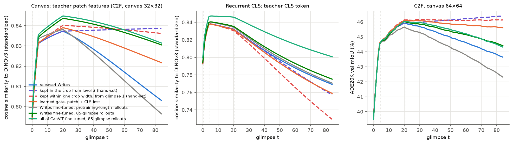

### Most of C2F's gain does not need new pixels

This test removes the detail finer than 128 px from the scenes (antialiased downsampling, then bilinear upsampling),
so no later glimpse holds information the first one lacks. Gain of C2F from t = 0 to t = 20 (seed 0):

| Scene | Gain (points) |
|---|---|
| original 512 px | +6.35 |
| detail of 256 px | +5.58 |
| detail of 128 px | +4.12 |

Without any new detail, C2F keeps two thirds of its gain.

A 128×128 canvas read by the 64×64 probe adds 0.2 points at t = 20 (46.15 vs 45.94), for twice the FLOPs per
glimpse.

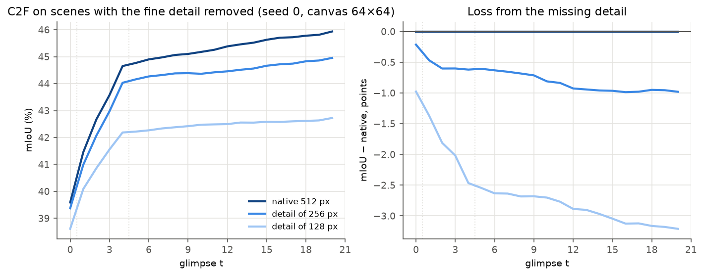

### Tile order within C2F's levels

Mean mIoU over glimpses 1-20:

| Order of the tiles in each level | 64×64 | 32×32 |
|---|---|---|
| lowest probe entropy first (EG-C2F reversed) | 44.50 | 43.00 |
| random, the paper's C2F (5 seeds, ± sd) | 44.92 ± 0.08 | 43.33 ± 0.04 |
| highest canvas contrast first (no probe) | 45.20 | 43.54 |
| highest probe entropy first, the paper's EG-C2F | 45.21 | 43.66 |
| most wrongly labeled pixels first (oracle: reads the labels) | 45.34 | 43.79 |

**Canvas contrast** needs no task head. A canvas cell's score is the mean cosine dissimilarity of its
layer-normalized patch to its four neighbours, and a tile's score is the mean over its cells.

- It matches EG-C2F on the 64×64 canvas and comes 0.12 points below it on the 32×32 canvas.
- The oracle bounds what any order gains over random at about 0.4-0.5 points.

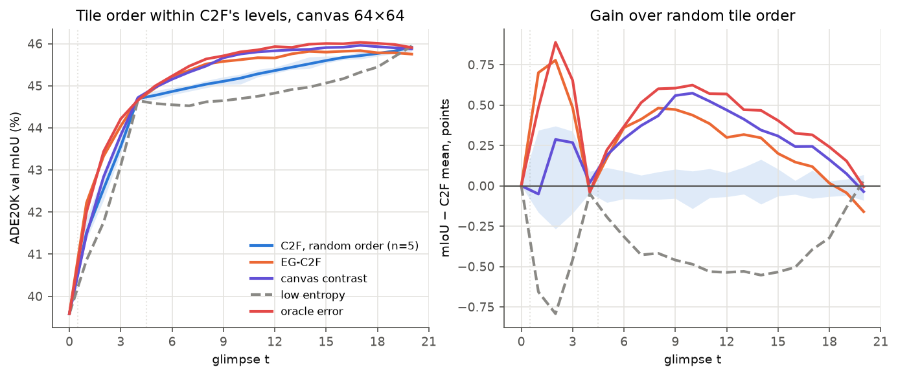

### Training-free changes that did not help

- **Anti-aliased glimpse extraction** (the crop at its native resolution, then an antialiased resize) lowers mIoU:
  - −0.48 at t = 0 on the 64×64 canvas;
  - −0.17 for C2F and −0.46 for RFS at t = 20.

  The model was pretrained on aliased bilinear glimpses. See
  [`outputs/ade20k_antialiasing.png`](outputs/ade20k_antialiasing.png).
- **Halving every Write residual after the first glimpse** slows RFS's decline (+0.30 at t = 84), but costs C2F up
  to 0.89 points (−0.50 at t = 20).
- **Glimpses of 256 px** (16×16 patches, 79 GFLOPs per glimpse instead of 21), on the first 500 images:
  - the full view gains 1.1 points at t = 0 (38.47 vs 37.37);
  - C2F ends lower at t = 20 (40.79 vs 42.02).

  DINOv3 gains 11.8 points from 128 to 256 px. CanViT, pretrained on 128 px glimpses only, does not.
- **Damping Writes where the canvas was already seen at a finer scale.** Inside the glimpse, Writes are multiplied by
  min(1, finest scale seen / glimpse scale)^k.
  - It is an exact no-op for C2F.
  - It hurts F2C at t = 20: −0.94, −1.69 and −2.62 for k = 0.5, 1 and 2 (seed 0).
  - It halves the loss from repeating the full scene after C2F (43.10 vs 40.17 at t = 84), which again points at
    repetition rather than coarseness.

### Cityscapes at 1024 px: past the pretraining resolution

Each Cityscapes validation image (1024×2048) is split into two 1024 px scenes, for 1,000 scenes. mIoU is over the 19
classes, at 1024 px. No Cityscapes probe is released, so [`scripts/cityscapes.py`](scripts/cityscapes.py) trains a
linear probe on the frozen 64×64 canvas, as the paper does for ADE20K:

- 512 px training scenes, 10 R-IID glimpses each, 8,000 steps;
- step selected on the validation split, with F-IID glimpses.

C2F to level 3 takes 85 glimpses. A level-3 tile spans 128 px of the 1024 px scene, so a glimpse can show it at full
resolution. Pretraining used 512 px scenes, where glimpses this small are always upsampled 2×.

| Writes | t = 20 | t = 84, level 3 upsampled from 512 px | t = 84, level 3 from 1024 px |
|---|---|---|---|
| released | 61.80 | 58.91 | 59.20 |
| kept in the crop from level 3 | 61.80 | 63.17 | 63.57 |
| kept in the crop from level 2 | 63.04 | | 64.70 |
| kept in the crop from glimpse 1 | 63.26 | 64.08 | 64.49 |

Levels 0-2 come from the 512 px scene, and t = 0 gives 49.51. Over three C2F seeds (mean ± sd), released Writes give
61.71 ± 0.11 at t = 20 and 59.13 ± 0.09 at t = 84. Writes kept in the crop from level 2 give 63.04 ± 0.02 and
64.65 ± 0.06.

- **Real detail adds little.** Over level 3, glimpses from the 1024 px scene beat upsampled ones by 0.29 to 0.41
  points at t = 84.
- **Keeping the Writes in the crop adds 4.4 points** at t = 84 (59.20 to 63.57).
- **Reading levels 0-2 from the 1024 px scene as well** changes the mIoU by at most 0.24 points.
- **Small classes suffer most from writes outside the crop.** With released Writes, from t = 20 to t = 84:
  - truck −9.6, traffic sign −9.3, pole −7.5, rider −7.2;
  - road +0.1, car +0.2.

  With Writes kept in the crop from level 3, every class gains, small ones most: traffic sign +4.7, traffic light
  +4.2.
- **Unlike on ADE20K, local Writes from glimpse 1 help before level 3:** +1.46 points at t = 20. Of that gain, 1.24
  points remain when Writes are kept in the crop from level 2 only. Keeping them in the crop from level 2 gives the
  best t = 84 (64.70).
- **Writes kept within half a crop width of the crop, from glimpse 1,** give the best mean over t = 1-20 (59.83,
  against 59.22 released and 59.71 with plain local Writes). They end lower than plain local Writes, though: 63.83
  at t = 84, against 64.49 from glimpse 1 and 64.70 from level 2. On Cityscapes, the leak near the crop also hurts
  over level 3.
- **A 128×128 canvas** (8 px cells at 1024 px), read by the 64×64 probe, adds about 0.4 points for twice the FLOPs
  per glimpse (42.3 GFLOPs). It drops over level 3 just as much: 62.21 at t = 20 and 59.78 at t = 84 with released
  Writes, 63.32 and 65.06 with Writes kept in the crop from level 2.
- **Subtracting only the mean of the residuals outside the crop** (from glimpse 1, level 3 from the 1024 px scene)
  fails here too: 59.50 at t = 20, 52.48 at t = 84.
- **EG-C2F:**
  - With released Writes, it gains 0.86 points in its first 10 level-3 glimpses (62.70 at t = 30), then loses them.
  - With Writes kept in the crop from glimpse 1, it reaches 64.40 at t = 36. C2F needs 84 glimpses for the same
    level (64.49).

**A CanViT-B pretrained on 1024 px scenes.** The Hub also holds
`canvitb16-add-vpe-pretrain-g128px-s1024px-sa1b-dv3b16-experimental`, pretrained on 1024 px SA-1B scenes. It is in
an older checkpoint format, which [`scripts/convert_legacy_checkpoint.py`](scripts/convert_legacy_checkpoint.py)
converts. Its probe is trained the same way, on 1024 px scenes. Levels 0-2 come from the 512 px scene and level 3
from the 1024 px scene, as above:

| Writes | t = 0 | t = 20 | t = 84 |
|---|---|---|---|
| released | 51.57 | 64.96 | 63.65 |
| kept in the crop from level 3 | 51.57 | 64.96 | 66.49 |
| kept in the crop from glimpse 1 | 51.57 | 65.88 | 66.63 |

- Its level-3 drop is half the flagship's (−1.31 points). Local Writes turn it into a gain of 1.53 points.
- **Real detail still adds little.** At t = 84:
  - level-3 tiles upsampled from the 512 px scene give 63.37 (−0.28);
  - every glimpse from the 1024 px scene, its pretraining scene size, gives 63.89 (+0.24).
- **EG-C2F with released Writes** peaks at 66.02 (t = 30), then falls to 64.25.
- **With every glimpse from the 1024 px scene and Writes kept in the crop from level 2**, C2F reaches 67.16 at
  t = 84 and EG-C2F 67.57 (t = 77). After 8 glimpses (167 GFLOPs), EG-C2F already scores 64.10.
- On this model too, the crop from level 2 ends highest. From glimpse 1, C2F ends at 66.87 with Writes kept in the
  crop and at 66.74 with a margin of a quarter crop width. Their means over t = 1-20 are a little higher, though
  (62.80 and 62.89, against 62.69).
- **The gap comes from the model, not from the probe.** A flagship probe trained on 1024 px scenes, like the 1024 px
  model's, gives the same curve as the one trained on 512 px scenes: 61.72 at t = 20 and 59.17 at t = 84, against
  61.80 and 59.20. The 3.2 points between the two models at t = 20 come from pretraining on 1024 px scenes.

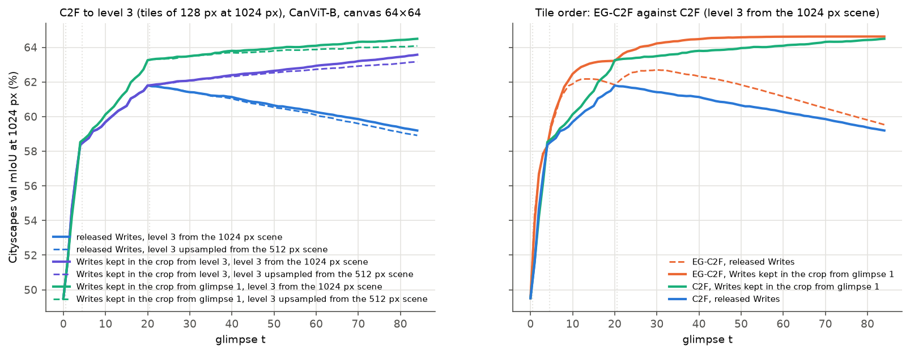

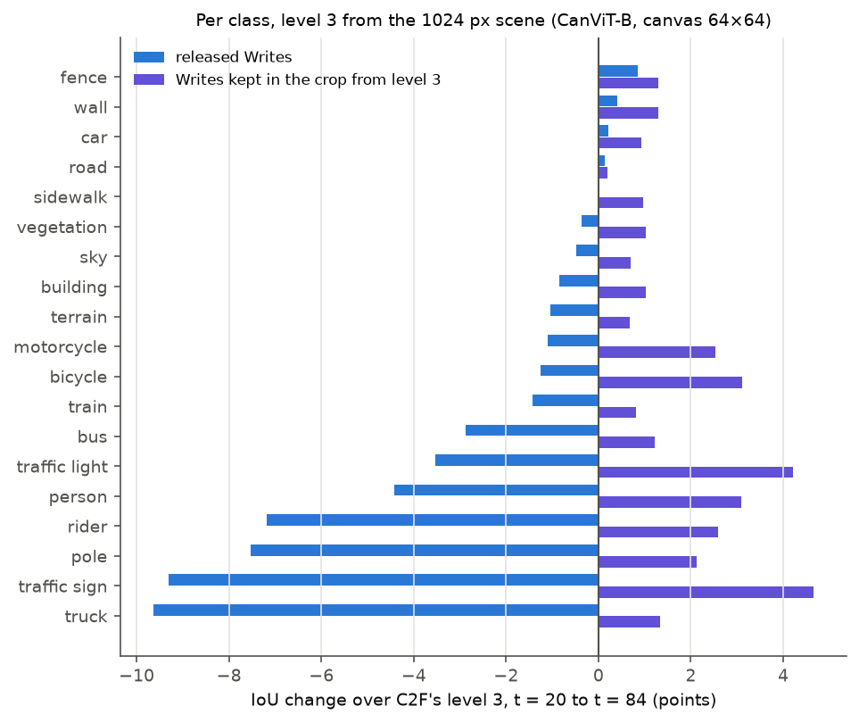

**Against DINOv3.** DINOv3 ViT-B/16 sees the scene once, resized to its input size, with a probe trained the same
way at that size. It scores 63.78 at 512 px (215 GFLOPs), 69.10 at 768 px (592 GFLOPs) and 71.99 at 1024 px
(1,322 GFLOPs). CanViT is ahead only on small budgets:

| Model | GFLOPs | mIoU |
|---|---|---|
| DINOv3 ViT-B/16, 512 px | 215 | 63.78 |
| CanViT-B pretrained on 1024 px, EG-C2F, Writes kept in the crop from level 2, 10 glimpses | 208 | 64.79 |
| DINOv3 ViT-B/16, 768 px | 592 | 69.10 |
| same CanViT, 28 glimpses | 583 | 66.88 |
| DINOv3 ViT-B/16, 1024 px | 1,322 | 71.99 |
| same CanViT, 64 glimpses | 1,334 | 67.56 |

The flagship CanViT stays below DINOv3 at 512 px for the same cost (61.83 after 10 glimpses of EG-C2F).

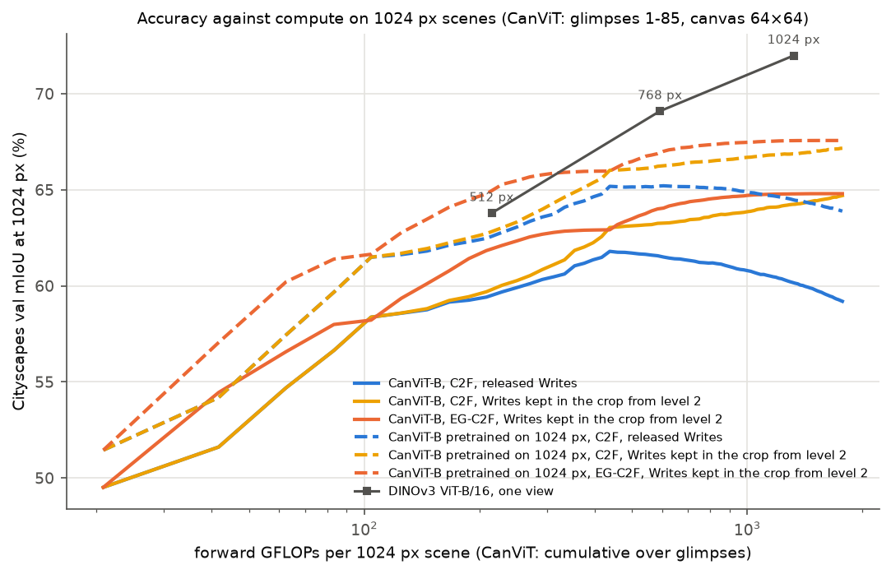

### Depth on NYU Depth v2: later glimpses add little

The paper does not test depth. [`scripts/nyu_depth.py`](scripts/nyu_depth.py) trains linear depth probes on frozen
features, on the labeled NYU Depth v2 set:

- 700 training images and 654 test images (the official split; the last 95 of its 795 training images select the
  probe's step);
- a scene is the central 480×480 square of an image, resized to 512 px. Errors are computed at 480 px, inside the
  crop of Eigen et al.;
- the probe is the paper's segmentation head over 256 depth bins (0-10 m), trained with the scale-invariant log
  loss. The canvas probe is trained on 10 R-IID glimpses per scene, as for Cityscapes.

| Features | GFLOPs | RMSE (m) | AbsRel | δ < 1.25 (%) |
|---|---|---|---|---|
| DINOv3 ViT-B/16, 128 px | 12 | 0.550 | 0.152 | 77.9 |
| CanViT-B, one glimpse (the full scene) | 21 | 0.554 | 0.155 | 77.9 |
| DINOv3 ViT-B/16, 256 px | 47 | 0.475 | 0.130 | 84.0 |
| CanViT-B, C2F, 10 glimpses | 208 | 0.525 | 0.146 | 80.0 |
| DINOv3 ViT-B/16, 512 px | 215 | 0.445 | 0.122 | 86.2 |
| CanViT-B, C2F, 21 glimpses | 438 | 0.524 | 0.149 | 79.9 |

- One glimpse matches DINOv3 at 128 px, but later glimpses add little. Over 20 more glimpses, C2F lowers the RMSE by
  0.030 m and F-IID by 0.027 m. On ADE20K, the same C2F glimpses add 6.35 points of mIoU.
- DINOv3 at 256 px (47 GFLOPs) beats CanViT at every budget.
- The canvas is trained to predict DINOv3's features of the 512 px scene. For segmentation, its probe comes close to
  DINOv3's at 512 px (45.9 against 47.2 mIoU); for depth, it does not (0.524 against 0.445 m).
- RFS degrades depth as it degrades segmentation: from 0.554 m at t = 0 to 0.586 m at t = 20.
- Over 21 glimpses, Writes kept in the crop from level 2 change nothing (0.527 m at t = 20).

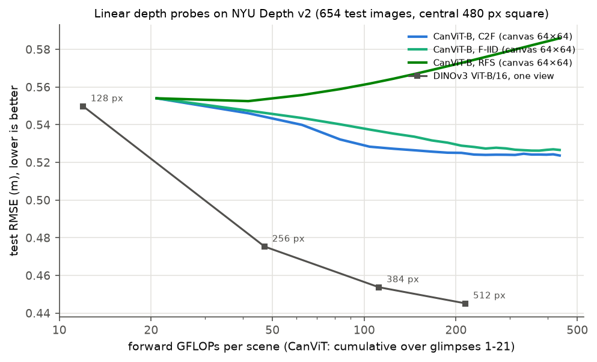

### Cost of the asymmetric Canvas Attention

The released model has no learned projections on the canvas side; the QKVO ablation has projections on both sides.

| Canvas | GFLOPs per glimpse, asymmetric / QKVO | Latency at batch size 32, asymmetric / QKVO |
|---|---|---|
| 64×64 | 20.8 / 124.3 | 103 / 158 ms |
| 128×128 | 42.3 / 455.0 | 361 / 580 ms |

FLOPs are analytic (`canvit_pytorch.flops`). Latency is measured on an RTX 3090 with bfloat16 autocast. At batch
size 1, both variants take 15-23 ms, a time bounded by kernel launches.

### Primate vision: eye movements, retinas and a canvas that learns its shape

CanViT samples a scene differently from a primate eye. The eye never holds still: fixational eye movements shift
the image by a fraction of a receptor, and they sharpen fine detail (Rucci et al., Nature 2007). The retina is
foveated, and receptive fields have their own positions, shapes and sizes. The population receptive field model of
fMRI fits one Gaussian per voxel (Dumoulin & Wandell 2008). Cortical maps also give more cells to what is used.
`scripts/bio_vision.py` builds each of these as a change to CanViT, most of them training-free:

- free positions: SR-RoPE computes every attention from scene positions alone, so glimpse patches and canvas cells
  can sit anywhere;
- microsaccade policies, and gaze biased to the center;
- foveated and learned retinas;
- glimpses that gather patches wherever the model is uncertain (patchworks);
- a canvas of learned Gaussian receptive fields, cell by cell or as a smooth warp of the grid;
- a canvas that grows fine cells where the eye zooms in;
- Writes that keep only what the cell does not hold yet (repetition suppression);
- Writes that spread along the seen object;
- learned RoPE wavelengths.

Four scripts use it:

- `scripts/bio_rollouts.py` measures ADE20K mIoU;
- `scripts/bio_reconstruction.py` computes the paper's reconstruction metric;
- `scripts/train_retina.py` trains a retina or canvas shape on the paper's objective and short rollouts, for 1000
  steps on ADE20K or Cityscapes training scenes, with CanViT frozen or fine-tuned, or measures the gradient on the
  canvas cells without training;
- `scripts/growing_canvas.py` runs the growing canvas.

With every mechanism off, `bio_rollouts.py` and `bio_reconstruction.py` give exactly the numbers of
`ade20k_rollouts.py` and `reconstruction_rollouts.py`.

**Microsaccades make repeated views useful.** Repeating the full scene degrades the canvas (RFS, above). Repeating a
view shifted by a fraction of a patch improves it and keeps it stable. ADE20K mIoU after 21 glimpses, 64×64 canvas:

| After the full scene, every glimpse is | t = 1 | t = 20 |
|---|---|---|
| the full scene again (RFS) | 41.06 | 39.32 |
| a centered view of scale 7/8 (control) | 42.13 | 40.16 |
| a view of scale 7/8 shifted by up to ±1/8 | 42.00 | 43.90 |
| a view of scale 0.75 shifted by up to ±0.25 | 42.28 | 44.22 |
| the full scene shifted by up to ±⅛ / ±¼ / ±½ patch | 41.49 / 41.57 / 41.96 | 41.31 / 42.32 / 43.03 |
| C2F (with zoom), for reference | 41.45 | 45.94 |

The full scene shifted by under a patch adds nothing to the crop; only the sampling phase changes. Even so, it gains
up to 3.7 points over RFS, more for larger shifts, much like the hyperacuity that eye movements give.

The effect holds elsewhere:

- Over three seeds, the shifted 7/8 views reach 43.90, 43.76 and 43.86 at t = 20.
- With 85 glimpses, the shifted 7/8 views stay at 43.58 (RFS: 37.55).
- On Cityscapes they reach 55.31 against 48.55 for RFS (C2F: 61.80). The native 1024 px scene shifted by up to
  1/16 of a patch reaches 52.60 (RFS on the native scene: 48.37).
- On the reconstruction metric (scene, standardized cosine at t = 20) they reach 0.8169 against 0.7716 for RFS
  (control: 0.7758; full scene shifted by up to ±1/16: 0.7926; C2F: 0.8373).

Some variants add nothing: sampling the views from the native 1024 px Cityscapes scene (aliased) instead of 512 px
(55.34), and a Halton sequence of shifts instead of random ones (43.80).

Shifts do not beat zoom. After C2F's 21 glimpses, revisiting the level-2 tiles with shifts of up to ±½ of their patch
ends at 45.05 at t = 84, against 44.68 without shifts and 43.65 for C2F's level 3. Its maximum (45.94, and 45.97 with
shifts of up to a full patch) only matches C2F's (45.93). With Writes kept in the crop from glimpse 21, shifted revisits end at 46.33, unshifted ones at 45.79, and C2F
at 46.40.

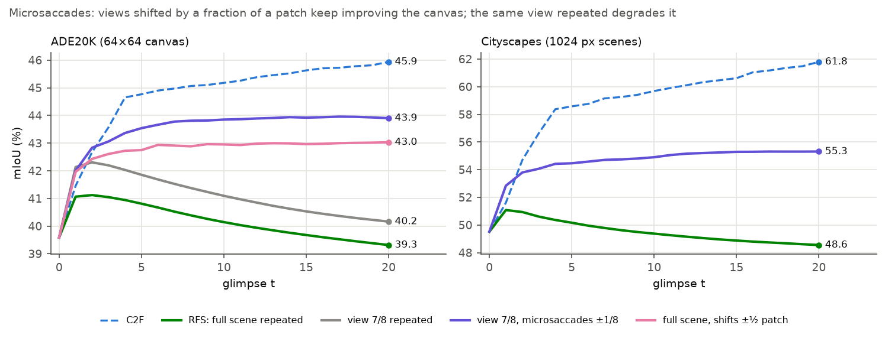

**A canvas that learns its shape falls back to the grid.** Each canvas cell gets a learned center and an elliptical
Gaussian. The center is its SR-RoPE position in the Reads and Writes. The Gaussian says which part of the scene the
cell stands for: the scene is read at any point as the cells' predictions weighted by their Gaussians. The canvas
starts as the released 32×32 grid with narrow Gaussians, where this reading is almost the identity. The variants are
trained on the paper's objective and read at the teacher's patch centers:

| Canvas (CanViT frozen unless noted) | Validation cosine, C2F / R-IID (t = 9) | ADE20K C2F, 32×32 probe (t = 20) |
|---|---|---|
| start (the released grid) | 0.8315 / 0.7865 | 44.31 |
| widths only (centers fixed) | 0.8314 / 0.7865 | 44.30 |
| centers and ellipses | 0.8292 / 0.7848 | 44.06 |
| reshaped for each scene (cells move by their content after the first glimpse) | 0.8279 / 0.7839 | 43.97 |
| the ellipse also weights what the cell receives in the Writes | 0.8242 / 0.7810 | 43.60 |
| plus an 8×8 grid of wider cells | 0.8286 / 0.7842 | 43.78 |
| 16×16 cells: widths only / centers and ellipses / reshaped for each scene | 0.8147 / 0.8148 / 0.8085 (C2F) | 41.58 / 41.72 / 41.19 |
| CanViT fine-tuned: uniform grid / centers and ellipses / reshaped for each scene | 0.8362 / 0.8341 / 0.8329 (C2F) | 44.01 / 43.98 / 43.89 |

No learned shape beats the grid, even with four times fewer cells than the targets. The cells move by about a
quarter of a spacing, with no structure. The model leaves the Write weighting unused: its strength stays at 0.017.
The wide cells shrink.

**The grid stays a grid when the input is uneven too.** Animals of open plains have a visual streak, a band of dense
ganglion cells along the horizon (Hughes 1977), and cortical maps grow what is used most. So the same trainings ran on
Cityscapes street views (sky at the top, road at the bottom, cars and people along the horizon) and on ADE20K with
gaze biased to the center (R-IID with each coordinate of the center within a tenth of the valid box 46% of the time).
A third variant deforms the grid smoothly instead of moving the cells one by one, as a cortical magnification map: a
learned height per row and width per column, 64 numbers for the 32×32 canvas. Validation cosine at t = 9 (C2F; under
central gaze, F-IID with central gaze):

| Canvas, CanViT frozen | ADE20K | Cityscapes | ADE20K, central gaze |
|---|---|---|---|
| 32×32: start | 0.8315 | 0.7540 | 0.8163 |
| 32×32: centers and ellipses | 0.8292 | 0.7510 | 0.8145 |
| 32×32: smooth warp | 0.8314 | 0.7536 | 0.8162 |
| 16×16: start / widths only / centers and ellipses | 0.8105 / 0.8147 / 0.8148 | 0.7349 / 0.7385 / 0.7389 | 0.7979 / 0.8020 / 0.8027 |
| 16×16: smooth warp | 0.8154 | 0.7389 | 0.8029 |

No canvas gathers its cells along the horizon or at the center. On a 16×16 budget, every learned shape gains about
0.004, on ADE20K as much as elsewhere. The gain comes from reading the 32×32 targets more smoothly: wider Gaussians,
or, for the smooth warp, a shift of the whole grid by a quarter of a cell (half a target patch), the same on both
datasets.

The gradient on the cells' centers at the starting grid shows why. It was measured over 500 training steps without
updates. On ADE20K and under central gaze it is noise: 2.1% and 2.9% of its components lie beyond 3 standard errors,
against 0.3% for pure noise. Adam moves every center by about its learning rate at each step, however small the
gradient, so the cells random-walk. On Cityscapes, 17.7% of the components lie beyond 3 standard errors. The pull
points down, toward the bottom of the image, where the canvas reconstructs worst, not toward the horizon. The smooth
warp, whose 64 numbers each sum the gradient of 32 cells, follows it: its bottom rows tighten by 2%. It gains there
and loses as much in the middle (−0.0004 in all). With a learning rate 10 times higher, bands of rows move by up to 23%
and the canvas loses 0.0026. For the released model, the grid is close to optimal.

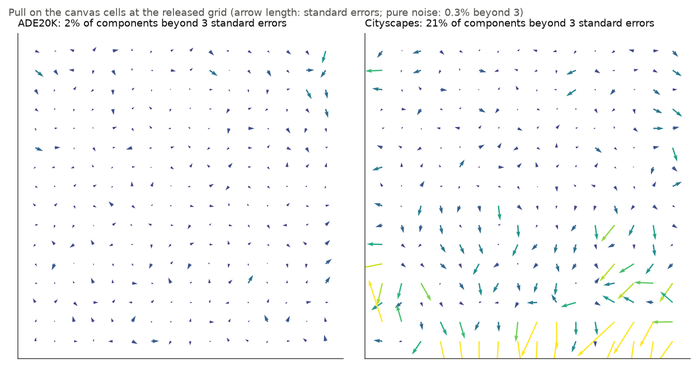

**A canvas that grows where the eye zooms in.** The canvas starts at 32×32. The first glimpses of C2F's level 2
(native resolution) recruit cells at 64×64 density in their crop, which inherit the coarse canvas there. mIoU at
t = 20:

| Fine tiles | Cells | Random tile order | Most uncertain tiles first (EG-C2F order) |
|---|---|---|---|
| 0 | 1,024 | 44.16 | 44.05 |
| 4 | 2,048 | 44.48 | 44.54 |
| 8 | 3,072 | 44.82 | 44.92 |
| 16 | 5,120 | 45.43 | 45.30 |
| uniform 64×64 canvas from the start | 4,096 | 45.94 | 45.75 |

The gain grows about in proportion to the area made fine. Putting the fine cells where the model is uncertain helps a
little more: at t = 8, 44.36 against 43.76 for random tiles. But a canvas grown during the rollout stays below one that
is fine from the start. Cells recruited at level 2 have missed the first five glimpses.

**Learned retinas: a weak fovea emerges only without zoom.** Each of the 64 glimpse patches gets a learned center and
size (192 parameters). This is the question of Cheung, Weiss & Olshausen (ICLR 2017): their learned sampling lattice
became foveated when the model could only move its glimpse, not when it could also zoom.

- **With zoom** (F-IID and R-IID), the retina stays the released grid. Its rings are 0.252 / 0.240 / 0.256 apart,
  against 0.25 on the grid.
- **Without zoom** (every glimpse of scale 0.5 at a random center), the rings grow apart outward: 0.246 / 0.264 /
  0.285. The outer patches leave the crop, so the retina covers 1.10 to 1.12 times the crop.

Both models (frozen, and fine-tuned with the retina) learn this geometry. So do a second seed (0.236 / 0.266 /
0.297), saccades of scale 0.25 (0.244 / 0.269 / 0.294), and a training twice as long, whose outer ring moves out
further (0.239 / 0.257 / 0.301, 1.16 times the crop).

Saccades at scale 0.5, ADE20K mIoU:

| Model | t = 0 | t = 20 |
|---|---|---|
| released | 24.80 | 43.75 |
| released, uniform views of scale 0.55 / 0.56 (wider field, control) | 26.79 / 27.16 | 43.92 / 43.83 |
| learned retina, CanViT frozen | 25.60 | 44.32 |
| the same, second seed / trained twice as long | 25.62 / 25.97 | 44.44 / 44.55 |
| CanViT fine-tuned: uniform / learned / foveal warp | 24.84 / 25.79 / 21.56 | 43.67 / 44.01 / 40.93 |

A wider field explains only part of the gain. At scale 0.25, the retina learned there gains as much (38.82 at
t = 20, released 38.07).

The retina specializes. Used with zoom, the one learned without zoom loses: C2F at t = 20 gives 44.77, against
45.94 on the released grid and 45.68 for the retina learned with zoom. A foveal warp imposed by hand (log-polar)
loses with zoom too: C2F at t = 20 gives 43.57 with the released model (central patches 1.4 times finer) and 43.32
after fine-tuning (2.5 times finer), against 45.73 for the same fine-tuning on the uniform grid.

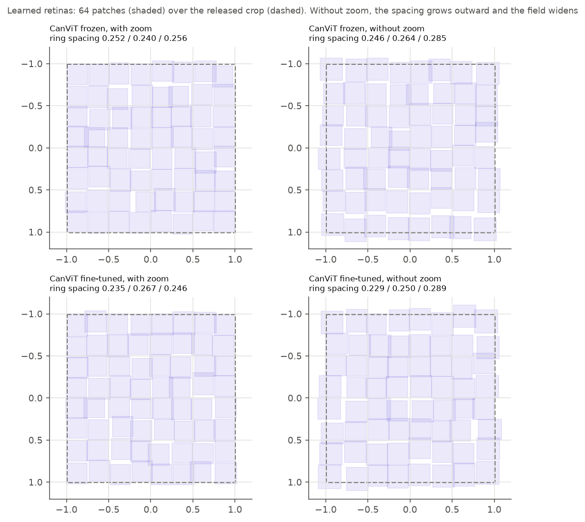

**Glimpses shaped by uncertainty lose to square tiles.** Attention is not always a square: it can take the shape of
an object. Free positions let a glimpse be any set of patches, each placed by SR-RoPE at its own position in the
scene. After C2F's levels 0 and 1, every glimpse of the patchwork policy gathers the 64 level-2 patches (16 px of the
512 px scene) where the probe's predictive entropy is highest, among those not taken yet. After 16 such glimpses,
every level-2 patch has been seen once, as after C2F's level 2. The control takes the patches at random. Blocks of
2×2 or 4×4 patches, contiguous in the glimpse as in the scene, sit in between; 8×8 blocks are whole tiles. ADE20K
mIoU, 64×64 canvas:

| Glimpses from t = 5 | t = 5 | t = 8 | t = 20 |
|---|---|---|---|
| C2F (square tiles, random order) | 44.77 | 45.06 | 45.94 |
| EG-C2F (square tiles, most uncertain first) | 44.94 | 45.52 | 45.75 |
| most uncertain patches: single / 2×2 / 4×4 blocks | 45.15 / 45.11 / 45.08 | 45.45 / 45.60 / 45.45 | 44.14 / 44.82 / 45.27 |
| random patches: single / 2×2 / 4×4 blocks | 44.74 / 44.70 / 44.69 | 44.61 / 44.80 / 44.92 | 42.88 / 44.13 / 45.20 |
| most uncertain single patches, Writes kept in the patches | 45.07 | 45.35 | 45.49 |

The first patchwork glimpse beats EG-C2F's first tile (45.15 against 44.94). After that, the more a glimpse is split,
the more the canvas degrades: at random, single patches lose 3.1 points by t = 20. The model was pretrained on square
crops. Keeping the Writes inside the patches stops the decline, but the canvas saturates below C2F.

Fine-tuning CanViT for 1000 steps with half of the rollouts as random patchworks (blocks of 1, 2 or 4 patches) helps
in part. At t = 20, random single patches reach 43.42 and the most uncertain ones 44.24, against 42.46 and 43.82 for
the same fine-tuning without patchworks. C2F is unchanged (45.69 against 45.73). Three times longer adds little:
43.52 for random single patches, while C2F falls to 45.50.

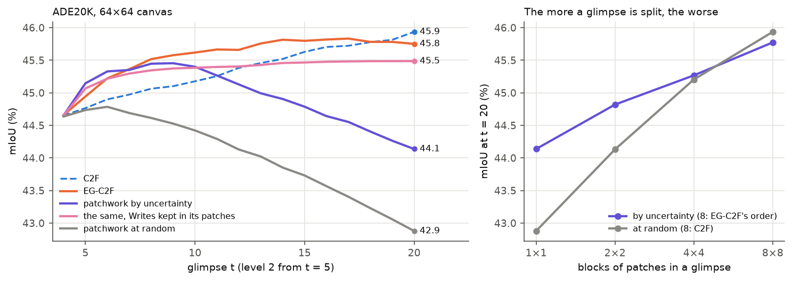

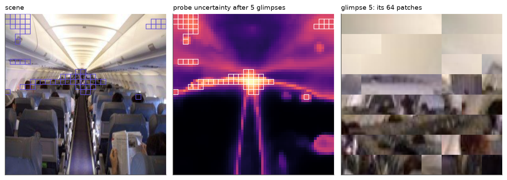

**Writes that spread along the object give the best training-free C2F.** Attention spreads along the attended
object, beyond the attended place (Egly, Driver & Rafal 1994). With object Writes, a Write reaches a canvas cell
outside the glimpse's crop only if that cell's content, before the glimpse, resembles one of the cells inside the
crop (cosine similarity of the layer-normalized cells at least a threshold). The released model writes into every
cell; local Writes (above) into the crop only. ADE20K mIoU, C2F to level 3, 64×64 canvas:

| Writes | Threshold | t = 20 | t = 84 | Outside cells reached at t = 84 |
|---|---|---|---|---|
| into every cell (released) | | 45.93 | 43.65 | all |
| into the crop only, from glimpse 21 | | 45.93 | 46.40 | none |
| into the crop and one crop width around it, from glimpse 1 | | 46.14 | 46.14 | |
| object, from glimpse 21 | 0.9 / 0.93 / 0.95 / 0.97 | 45.93 | 46.23 / 46.42 / 46.53 / 46.57 | 35 / 24 / 17 / 10% |
| object, from glimpse 5 | 0.85 / 0.9 / 0.95 / 0.97 | 46.20 / 46.29 / 46.29 / 46.25 | 46.08 / 46.45 / 46.53 / 46.40 | 48 / 34 / 16 / 9% |
| object, from glimpse 1 | 0.9 / 0.95 | 46.24 / 46.14 | 46.37 / 46.36 | 33 / 16% |
| object, 0.9 from glimpse 5, then 0.97 from glimpse 21 | | 46.29 | 46.61 | 10% |

From glimpse 5 at 0.9 or 0.95, the object Writes give the best t = 20 of every ADE20K run here, fine-tuned ones
included: 0.36 above C2F. With a stricter threshold for level 3, they also give the best t = 84 of all the changes to the
Writes here, fine-tuned ones included (at most 46.54). Seed 1 confirms both: 46.30 at t = 20 (C2F: 45.89) and 46.55
at t = 84 (crop only from glimpse 21: 46.31). With seed 1, 0.95 from glimpse 5 gives 46.31 / 46.46, and 0.95 from
glimpse 21 gives 46.42 at t = 84. With EG-C2F's tile order, object Writes from glimpse 5 at 0.9 reach 46.21 at
t = 20 (EG-C2F: 45.75). Microsaccades instead of level 3, with object Writes, end at 46.47.

On Cityscapes the threshold must be stricter. From glimpse 5 at 0.97, C2F gives 63.46 at t = 20 and 64.81 at
t = 84, against 63.04 and 64.70 with Writes kept in the crop from glimpse 5. With seed 1 the numbers are 63.45 /
64.75, against 63.03 / 64.59. At t = 20 the gain (0.42) is more than ten times the spread of local Writes over three seeds. With
looser thresholds, object Writes only match local Writes or lose. From glimpse 5, C2F gives 63.35 / 64.53 at 0.95
and 62.96 / 63.57 at 0.9. From glimpse 21 at 0.95, it ends at 63.52 (crop only: 63.57). At 0.98 from glimpse 5,
it gives 63.46 / 64.86. So the threshold 0.97 from glimpse 5 suits both datasets: 46.25 / 46.40 on ADE20K (seed 1: 46.28 / 46.37).

The same setting helps the Hub's experimental 1024 px CanViT-B a little, on native Cityscapes scenes. C2F gives
66.23 / 67.23 against 66.02 / 67.16 for local Writes from glimpse 5 (seed 1: 66.12 / 67.11 against 65.96 / 67.09).
EG-C2F's order gives 67.72 at t = 84 (local Writes: 67.57), the best Cityscapes result here.

On NYU Depth v2 (C2F, t = 20; RMSE in m / AbsRel / δ < 1.25 in %), local Writes lower AbsRel but raise the RMSE.
Object Writes from glimpse 5 at 0.9 lower both: 0.522 / 0.146 / 80.25, against 0.524 / 0.149 / 79.94 for the
released Writes and 0.527 / 0.146 / 79.95 for local ones. Seed 1 gives the same picture: 0.522 / 0.146 / 80.26,
against 0.523 / 0.149 / 79.95 and 0.526 / 0.146 / 80.00. The changes are small, as are all changes after the first
glimpse on depth (above).

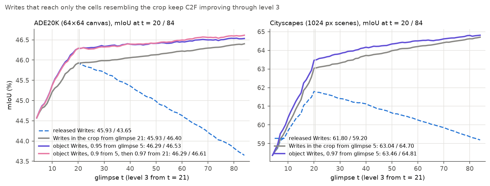

**What did not help:**

- *Repetition suppression.* Removing from each Write the part along what the cell already holds removes about 60% of
  it. It lowers RFS at t = 84 from 37.55 to 35.53, and C2F from 43.65 to 23.48.
- *A canvas spread by a hand-set density.* With the ground truth's boundaries, it gains 0.22 at t = 20.
- *Learned RoPE wavelengths, fine-tuned.* The finest shrink by 2–3%, and C2F gives 45.74 at t = 20 (uniform
  fine-tuning: 45.73).
- *Fine-tuning with a third of the rollouts as microsaccades.* Shifted views give 43.46 at t = 20 (43.52 without).

### The whole CanViT family: the same leak, the same fix, and which cells a Write should reach

The Hub's `canvit` organization also releases the paper's twelve pretraining ablations (a shorter schedule of
214,656 steps) and a pretraining on ImageNet-1k, each with an ADE20K probe on the 32×32 canvas: fourteen pretrained
CanViT-B in all. [`scripts/bio_rollouts.py`](scripts/bio_rollouts.py) loads any of them with `--model in1k` or
`--model abl-<slug>`. Unless noted, the runs below use C2F for 85 glimpses on the 32×32 canvas, in batches of 32 (the
batch sets the tile orders, so all the conditions of a model share them), with the mIoU after every glimpse up to
t = 20 and every fourth one after. Intervals are 95% paired bootstraps over the 2,000 images
([`scripts/paired_bootstrap.py`](scripts/paired_bootstrap.py), on the per-image counts each run saves next to its
result, `*.per_image.pt`, which are not kept in the repository).

**Every pretraining drifts past level 2, and local Writes repair every one.** The leak is measured by
[`scripts/write_leakage.py`](scripts/write_leakage.py) on 128 scenes: the share of the outside cells' attention on
the glimpse's positionless prefix tokens at level 3, the token that takes most of it, and the leaked residuals summed
over level 3 relative to the cell's own.

| Pretraining | t = 20 | t = 84, released | t = 84, local Writes from level 3 | prefix share (top token) | leak |
|---|---|---|---|---|---|
| flagship (IN-21k) | 44.20 | 41.05 (−7.1%) | 44.48 | 0.95 (register 3: 0.92) | 8.3× |
| IN-1k | 42.03 | 40.38 (−3.9%) | 42.42 | 0.92 (register 2: 0.77) | 8.7× |
| ablation baseline | 38.06 | 35.29 (−7.3%) | 38.64 | 0.96 (register 3: 0.79) | 8.5× |
| D_can 256 + QKVO | 34.66 | 33.64 (−2.9%) | 34.97 | 0.96 (register 1: 0.91) | 6.6× |
| D_can 384 + QKVO | 36.38 | 35.30 (−3.0%) | 36.54 | 0.97 (register 4: 0.69) | 4.3× |
| D_can 256 | 34.26 | 33.70 (−1.6%) | 34.61 | 0.97 (VPE: 0.91) | 7.6× |
| 1 Read / 1 Write | 34.06 | 29.03 (−14.8%) | 34.51 | 0.96 (VPE: 0.28) | 10.5× |
| no Reads | 31.90 | 26.33 (−17.4%) | 32.33 | 1.00 (VPE: 0.99) | 12.8× |
| no VPE | 37.11 | 33.01 (−11.0%) | 37.59 | 0.97 (register 3: 0.90) | 10.4× |
| ViT-S backbone | 32.38 | 27.99 (−13.5%) | 32.81 | 0.97 (register 0: 0.75) | 10.7× |
| no BPTT | 34.36 | 31.11 (−9.4%) | 34.87 | 0.97 (register 0: 0.50) | 7.5× |
| no dense loss | 17.77 | 14.61 (−17.8%) | 18.33 | 0.72 (register 2: 0.28) | 22.7× |
| no F-IID (1 R-IID) | 29.78 | 27.08 (−9.1%) | 30.47 | 0.89 (register 0: 0.39) | 13.7× |
| no F-IID (2 R-IID) | 32.27 | 29.87 (−7.4%) | 33.17 | 0.90 (register 4: 0.44) | 15.5× |

- All fourteen lose mIoU from t = 20 to t = 84 with released Writes, by 1.6% to 17.8%. With Writes kept in the crop
  from level 3, all fourteen end above their t = 20.
- Every model has a sink: the cells the glimpse does not cover put 89–100% of their attention on the positionless
  prefix (72% without the dense loss). Which token plays the sink is not built in: it is backbone register 0, 1, 2, 3
  or 4, or the VPE, depending on the run. In every model, 78–96% of the leak's energy is one vector added to every
  cell.
- The leak predicts the drop: Spearman ρ = −0.72 (p = 0.004) against the relative change from t = 20 to t = 84
  (−0.46 in points, as the models' mIoU ranges from 18 to 44). The two ablations trained without F-IID, on random
  glimpses only, lose less than their leak predicts.
- An output projection on the Writes (QKVO) does not remove the sink or the drop: at D_can 256, the QKVO model loses
  2.9%, the model without it 1.6%.
- **The paper's reconstruction metric agrees, without probes** (500 scenes, 13 models: the ablation without the
  dense loss has no trained patch head). The canvas's cosine similarity to DINOv3's features falls from t = 20 to
  t = 84 in all thirteen (flagship 0.8388 to 0.8053, no Reads 0.7122 to 0.6410), and local Writes bring it back to
  its t = 20 level or above (flagship 0.8401, no Reads 0.7122; at most 0.0006 below, for the two QKVO models and
  D_can 256). The CLS prediction falls too, and local Writes do not help it (flagship 0.835 to 0.777, local 0.767).
- Object Writes with the flagship's thresholds (0.9 from glimpse 5, 0.97 from 21) beat local ones on the flagship
  (44.68 / 44.69 at t = 20 / 84), IN-1k (42.55 / 42.85), the baseline (38.57 / 38.99), D_can 256 + QKVO (34.92 /
  35.16) and ViT-S (32.95 / 33.02). On 1 Read / 1 Write they do worse than local (34.11 / 32.99): its canvas cells
  are much more alike, and the same thresholds reach 95% of the outside cells at level 2 (42% on the flagship).

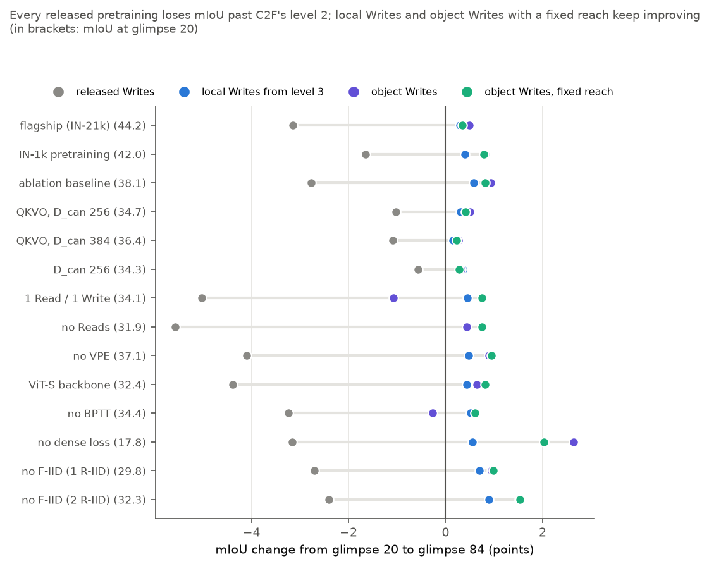

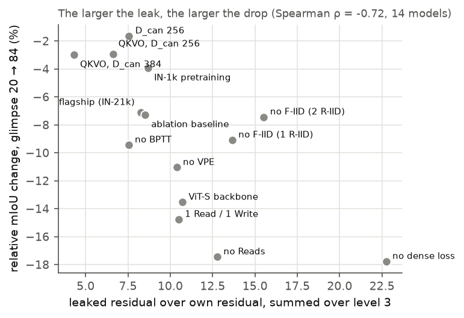

**Which outside cells a Write should reach.** Flagship, 64×64 canvas, C2F 85, from glimpse 5 unless noted. *Reach*
is the share of the outside cells written at levels 2 and 3. The last column compares each rule with object Writes at
t = 84.

| Outside cells a Write reaches | reach | t = 20 | t = 84 | t = 84, against object Writes |
|---|---|---|---|---|
| all (released) | 1 / 1 | 45.93 | 43.65 | −2.97 [−3.47, −2.50] |
| random, in the share of object Writes at 0.95 | 0.23 / 0.16 | 46.08 | 46.30 | |
| object Writes at 0.95 | 0.23 / 0.16 | 46.29 | 46.53 | |
| random from level 3, in the share of object Writes at 0.97 | 0 / 0.10 | 45.93 | 46.24 | |
| object Writes from level 3 at 0.97 | 0 / 0.10 | 45.93 | 46.57 | |
| none from level 3 (local) | 1 / 0 | 45.93 | 46.40 | −0.21 [−0.42, −0.02] |
| predicted class shared with the crop | 0.57 / 0.47 | 46.11 | 46.27 | −0.34 [−0.52, −0.15] |
| probe probabilities similar (cosine ≥ 0.99) | 0.43 / 0.34 | 46.09 | 46.39 | −0.22 [−0.40, −0.05] |
| object Writes, uncertain cells only (top probability < 0.7) | 0.11 / 0.08 | 46.27 | 46.39 | −0.23 [−0.41, −0.00] |
| **object Writes** (canvas similarity 0.9, then 0.97) | 0.42 / 0.10 | **46.29** | **46.61** | |
| *oracle:* ground-truth class shared with the crop | 0.51 / 0.42 | 46.84 | 47.71 | +1.10 [+0.89, +1.44] |
| *oracle,* only the cells the probe gets right | 0.42 / 0.35 | 45.57 | 45.65 | −0.96 [−1.16, −0.70] |
| *oracle,* only the cells the probe gets wrong | 0.08 / 0.06 | 47.30 | 48.39 | +1.78 [+1.59, +2.00] |

- Object Writes against released ones: +0.36 [+0.21, +0.55] at t = 20, above the paper's C2F number with no
  training, and +2.97 [+2.50, +3.47] at t = 84.
- Random outside cells in the object Writes' share do worse than the object Writes (46.30 against 46.53, and 46.24
  against 46.57 from level 3), and from level 3 worse than writing none (46.40): which cells, not how many.
- Grouping by the probe is more precise by class than canvas similarity (on 32 scenes, 95–96% of the cells with
  similar probabilities share a class with the crop, against 89–92% for canvas similarity 0.9 at a similar reach), yet
  it does worse.
- The oracle explains why. Restricted to the same-class cells the probe already gets right, it is worse than writing
  none (45.65). Restricted to the ones it gets wrong, 6–8% of the outside cells, it beats the full oracle (48.39). A Write into a cell
  the model gets right harms it, even when the labels agree; its gain is in correcting the others, which no rule
  built on the model's own predictions can find. On 32 scenes, 87–89% of the cells object Writes reach are already
  right, and requiring the probe to be unsure there (top probability below 0.7) keeps 45–70% of the wrong ones but
  still writes into right ones (53–60% of the cells it reaches): no better.

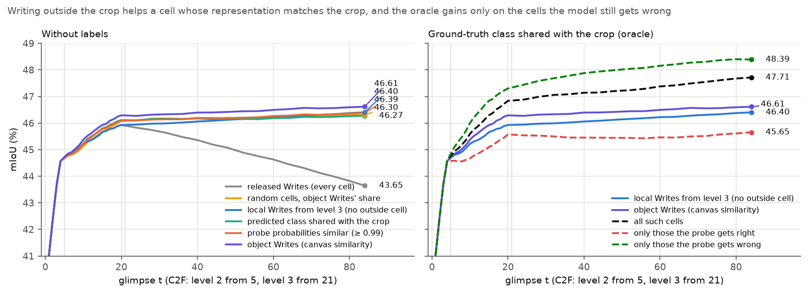

**Gating the Writes by their own sink attention fails.** It would need no viewpoint: from some glimpse on, a cell
keeps a Write's residual only if it puts less than a threshold of its attention on the prefix tokens
(`local_writes.SinkGatedWrites`). Inside the crop, the prefix gets 0.24–0.47 of the attention, outside 0.74–0.98, so
the threshold separates them. Yet from level 3 at 0.9, C2F collapses to 38.96 at t = 84. The outside cells that escape
the sink are the ones attending to real patches, so the gate keeps exactly the largest, content-bearing leaked
residuals. Those cells drift, escape the sink more, and the share of outside cells kept grows from 22% at t = 21 to 55%
at t = 84, while the canvas norm reaches 123k (58k with released Writes). At 0.7 it ends at 45.66, below local Writes;
from glimpse 5 at 0.9 or from glimpse 1 at 0.97, it ends at 38.85 and 39.66.

**Longer than C2F.** After C2F's 85 glimpses, a second pass over the 64 level-3 tiles, each view shifted by at most
half a level-3 patch (`--policy c2f_then_jittered_level3`, 32×32 canvas): released Writes keep falling (44.07,
41.09, 37.58 at t = 20, 84, 148); local Writes stay level (44.07, 44.37, 44.32), and object Writes too (44.55, 44.63,
44.30).

**ImageNet-1k: the recurrent CLS forgets for another reason.** [`scripts/imagenet_rollouts.py`](scripts/imagenet_rollouts.py)
runs the released fine-tuned classifier, which reads the recurrent CLS token, on 10,000 validation images (every
fifth), C2F, 32×32 canvas. Top-1 rises from 80.45 (full view) to 84.98 at t = 11 and falls to 83.45 at t = 84. Local
Writes barely change it (83.63, +0.18 [−0.06, +0.42]), nor do object Writes (83.42): the CLS sees the canvas only
through the Reads, and at level 3 each glimpse's tile overwrites it. Accumulating its evidence over the glimpses, as
sequential-sampling models of decisions do, recovers most of the drop: the mean of the class probabilities so far
gives 84.96 at t = 20 and 84.52 at t = 84 (+1.07 [+0.78, +1.37] over the CLS alone), with a maximum of 85.07 at
t = 27; the sum of the log-probabilities gives 84.51 at t = 84.

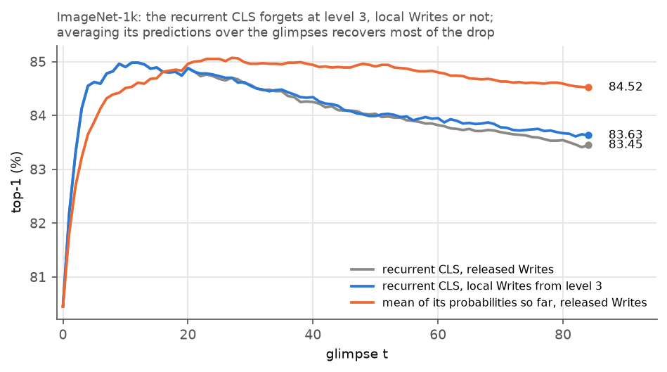

### Limits

- Four datasets. On Cityscapes and NYU Depth v2, the probes are trained here; ImageNet-1k uses a fifth of the
  validation set (10,000 images). Every Cityscapes run uses one seed,
  except the comparison of released Writes with Writes kept in the crop from level 2 (three seeds) and the object
  Writes from glimpse 5 at 0.97 (two seeds). Each depth probe is trained once.
- Deterministic policies (RFS, EG-C2F and the scored tile orders) ran once; the others ran over the seeds shown.
  Variants of C2F use seed 0.
- Apart from the section Learned Writes (at most 400 steps on ADE20K, against 2 million steps of pretraining),
  nothing in CanViT is retrained, so the conclusions hold for the released model. Local Writes are a change at
  inference only; a model pretrained with them may behave differently.
- Most segmentation probes were trained on the released canvas. A probe trained on a fine-tuned canvas reads it
  better (0.4 to 0.9 points on Cityscapes).
- The primate-vision trainings (learned retinas, canvas shapes, RoPE wavelengths) run 1000 steps of short rollouts on
  ADE20K or Cityscapes training scenes, from the released model, once each except the no-zoom retina (two seeds). A
  model pretrained with a learned retina or canvas from the start may settle elsewhere.
- The family study uses each model's released 32×32 probe and one C2F tile order per model; the ablations were
  pretrained on a shorter schedule than the flagship and read lower. The object Writes' thresholds were chosen on the
  flagship, and the grouping rules and the oracle's halves were compared on the flagship only. The bootstrap
  intervals cover which images the benchmark holds, not the tile order or the probe.

## Setup

```bash
python3.12 -m venv .venv
.venv/bin/pip install "canvit-pytorch[demo,evaluate]==0.3.0"
git clone https://github.com/m2b3/CanViT external/CanViT   # the paper's exported results, sample images
```

ADE20K (`ADEChallengeData2016`) goes wherever `ADE20K_ROOT` points, Cityscapes (`gtFine_trainvaltest.zip` and
`leftImg8bit_trainvaltest.zip`, unzipped) wherever `CITYSCAPES_ROOT` points, NYU Depth v2
(`nyu_depth_v2_labeled.mat` and `splits.mat`) wherever `NYU_ROOT` points, and the ImageNet-1k validation images (one
subdirectory per class) wherever `IMAGENET_VAL` points; the queue runners and scripts set the defaults. The depth script also needs `h5py` and `scipy`. DINOv3 is gated on the Hugging Face Hub: request access, then `hf auth login`.

## Contents

| Path | What it does |
| --- | --- |
| `scripts/c2f_rollout.py` | One scene under C2F: numbered viewpoints, the canvas after each glimpse (the paper's PCA protocol) and the per-glimpse canvas change. |
| `scripts/ade20k_rollouts.py` | ADE20K validation mIoU after every glimpse, with canvas statistics, for the paper's policies and for variants: other tile orders within C2F's levels, C2F continued past level 2 by revisits, anti-aliased glimpses, scenes without fine detail, a probe read on a larger canvas, scaled Write residuals, Writes damped where the canvas was already seen at a finer scale or averaged over a cell's views, Writes kept in the glimpse's crop, learned changes to the Writes. Uses the official model, probe, transform and metric. |
| `scripts/level3_canvas.py` | The canvas and the probe's prediction after level 3 of C2F with released and local Writes, on a few ADE20K scenes. |
| `scripts/write_leak_map.py` | Where one glimpse's Writes land on one scene: residual norm and attention on the sink register, per canvas cell. |
| `scripts/write_leakage.py` | How much of each Write lands outside the glimpse's crop, per C2F level, and how much of it comes from the glimpse's prefix tokens. |
| `scripts/local_writes.py` | The training-free restrictions of the Writes to the glimpse's crop that the rollout scripts share, and the learned changes: a distance gate on the Writes, a zero-value key, the Writes' own parameters, the Reads' too, or all of CanViT's. |
| `scripts/train_write_gate.py` | Trains one of those learned changes, the rest of CanViT frozen, on the pretraining objective with long rollouts, optionally with local Writes applied during training. |
| `scripts/reconstruction_rollouts.py` | The paper's reconstruction metric (no task probe) after every glimpse, with released or local Writes. |
| `scripts/nyu_depth.py` | NYU Depth v2: linear depth probes on frozen features (CanViT's canvas, DINOv3's patch features), then test depth errors after every glimpse of CanViT (with released, local or object Writes) and for DINOv3 at several input sizes. |
| `scripts/cityscapes.py` | Cityscapes at its native 1024 px: linear probes trained on frozen features (CanViT's canvas, DINOv3's patch features), then validation mIoU of C2F rollouts down to glimpses finer than the 512 px scenes of pretraining (with released, local or object Writes), of microsaccades, and of DINOv3 at several input sizes. |
| `scripts/bio_vision.py` | The primate-vision mechanisms: CanViT's forward with free glimpse and canvas positions, microsaccade and central-gaze policies, foveated and learned retinas, patchwork glimpses, a canvas of learned Gaussian receptive fields (with a Write footprint, coarser cells, a per-scene reshaping, or a smooth warp), a canvas that grows where the eye zooms in, repetition-suppressing and object-shaped Writes, learned RoPE wavelengths. |
| `scripts/bio_rollouts.py`, `scripts/bio_reconstruction.py` | ADE20K mIoU and the paper's reconstruction metric after every glimpse with those mechanisms, or with a training of `train_retina.py`, for any released pretraining (`--model`); the controls of the object Writes (random cells in their share, the ground-truth oracle and its halves, grouping by the probe), sink-gated Writes, rollouts past C2F; per-image counts for paired bootstraps. |
| `scripts/imagenet_rollouts.py` | ImageNet-1k top-1 after every glimpse from the released fine-tuned classifier's recurrent CLS, with released, local or object Writes, and with its evidence accumulated over the glimpses. |
| `scripts/paired_bootstrap.py` | Paired bootstrap interval of the difference between two runs on the same images (ADE20K mIoU or ImageNet top-1). |
| `scripts/plot_family.py` | The family and outside-cell figures in `outputs/family_*.png`, `outputs/write_which_cells.png` and `outputs/imagenet_glimpses.png`. |
| `scripts/train_retina.py` | Learns a retina, a canvas shape or RoPE wavelengths, with CanViT frozen or fine-tuned, on the paper's objective and short rollouts of ADE20K or Cityscapes scenes (with or without zoom, with gaze biased to the center, optionally with microsaccade rollouts); or saves the gradient on the canvas cells at the starting grid. |
| `scripts/growing_canvas.py` | ADE20K mIoU of a 32×32 canvas that recruits 64×64-density cells in the crops of the first level-2 glimpses. |
| `scripts/plot_bio.py` | The primate-vision figures in `outputs/bio_*.png`. |
| `scripts/convert_legacy_checkpoint.py` | Converts a checkpoint in the canvit-pytorch 0.1 format (the Hub's experimental 1024 px CanViT-B) to the current format. |
| `scripts/run_queue.sh`, `scripts/run_official_queue.sh`, `scripts/run_commands.sh`, `queues/` | Run a list of experiments one after another, skipping finished ones: `ade20k_rollouts.py` runs, official `canvit_pytorch.evaluate` runs, and any Python command. |
| `scripts/plot_results.py` | Figures in `outputs/` and the table `results/summary.md` from the saved results. |
| `scripts/canvas_attention_cost.py` | FLOPs and GPU latency of a glimpse with asymmetric and QKVO Canvas Attention. |
| `scripts/export_official.py` | Collects the official CLI's runs (DINOv3 baselines, reconstruction) into `results/official.json`, with the FLOPs of each model. |
| `exercises/` | Canvas Attention and SR-RoPE to write from the paper, with a checker against the released model. |

## Checks

- On RFS with a 64×64 canvas, `scripts/ade20k_rollouts.py` gives the same mIoU after each of the 21 glimpses as
  `python -m canvit_pytorch.evaluate ade20k-segmentation-canvit`.
- Its tile-ordered C2F with the probe's entropy as score chooses the same viewpoints as the official EG-C2F.
- On RFS (21 glimpses), `scripts/reconstruction_rollouts.py` gives the same four reconstruction metrics after each
  glimpse as `python -m canvit_pytorch.evaluate reconstruction` (difference 0).

Results are in `results/` (one JSON file per run, with its configuration) and summarized in `results/summary.md`.
